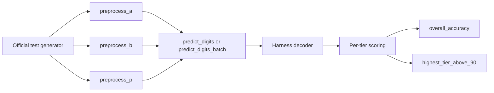
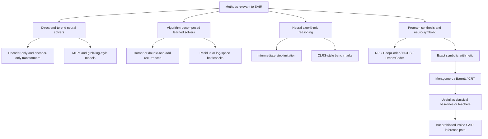
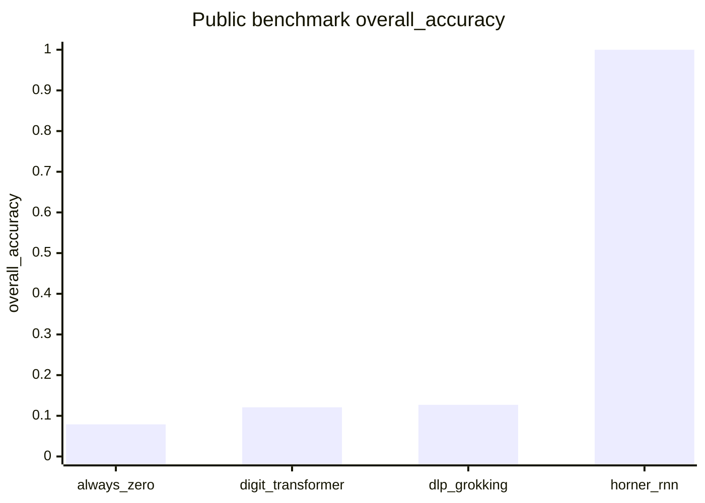

# Deep Research Report on the SAIR Modular Arithmetic Challenge

## Executive summary

The SAIR Modular Arithmetic Challenge asks models to compute \((a \times b) \bmod p\) from three **decimal-string** inputs, where \(a\) and \(b\) can be up to about **1233 decimal digits** and the prime \(p\) up to about **617 decimal digits**. The competition is unusual because it explicitly forbids solving the task by inserting a classical arithmetic algorithm into inference-time code; instead, the answer must be produced by the model’s **trained parameters** through a narrow interface of three per-argument preprocessing hooks plus `predict_digits`, with the harness—not the submission—handling decoding and scoring. The official evaluation uses **11 tiers**: Tier 0 is an unscored diagnostic for pure multiplication, and Tiers 1–10 are scored; ranking is by `highest_tier_above_90`, then `overall_accuracy`. The official public benchmark contains **1100 cases** with a fixed seed, **5 primes per scored tier**, and mandatory edge cases like \(a=0,1\) and \(b=0,1\). The reference runtime budget is **5 minutes for all 1100 problems** and a **20 GB** artifact cap. citeturn41view0turn43view0turn7search0

Among the **official example submissions**, the gap between trivial and modestly neural baselines is small: `always_zero` scores **0.079**, the ~**544K**-parameter `digit_transformer` scores **0.121**, and the ~**6M**-parameter `dlp_grokking` model scores **0.127** on the 1100-case public benchmark. By contrast, the strongest **publicly visible challenge-tagged** solution I found, `XllentAI/modular_arithmetic`, claims **1.000 overall_accuracy** and `highest_tier_above_90 = 10` on the public benchmark using a **carry-aware TCN** embedded in a **bit-sequential Horner-style recurrence**, with about **10.7M parameters**, a **0.04 GB** artifact, and roughly **174 seconds** inference on GPU. I could verify the model card and public challenge tag, but I did **not** directly verify a live official SAIR leaderboard entry from the competition site in the surfaced sources, so this should be treated as a **public model-card claim**, not as an independently confirmed official ranking. citeturn8view0turn9view0turn8view2turn12view0turn13view0turn14view0turn15view1

The broader literature strongly supports a central conclusion: **direct end-to-end neural learning of modular multiplication is much harder than modular addition**, especially when the model must generalize across many primes, longer operands, and genuine modular reduction. Grokking-style modular-addition papers, mechanistic-interpretability work, and recent transformer studies show that small models can learn modular addition and even discover Fourier-like structure; but modular multiplication, modular polynomials, and exponentiation remain substantially harder, and many otherwise strong models fail on **length generalization**, **position shifts**, or **distribution shifts** in prime/operand widths. Techniques that repeatedly emerge as helpful are: carefully chosen **input/output representations**, **task-aware losses**, **custom data distributions**, **repeated examples**, **curriculum or width matching**, **intermediate-step supervision**, and—most importantly for this competition—**algorithmically structured learned recurrences** rather than direct symbolic circuits. citeturn18search0turn33search0turn27search3turn33search1turn20search0turn20search1turn19search0turn19search3turn28view2turn28view0turn37view2

My bottom-line recommendation is to optimize for **compliant learned algorithm decomposition**, not for a generic decoder-only LLM baseline. If your goal is to maximize the chance of a strong SAIR competition submission under unspecified compute, the best evidence points toward a **learned Horner/double-and-add recurrence**, trained as a **single-step modular transition model** with **bit- or limb-level state**, **width-matched prime distributions**, **held-out-prime validation**, and **margin-style losses** for worst-bit robustness. A secondary recommendation is to include small-prime specialists—such as a discrete-log/additive-bottleneck submodel or tiny transformer branch—but only as supporting modules, because the official examples show these methods saturate early on the public benchmark. citeturn8view2turn9view0turn13view0turn14view0turn15view1

Two practical assumptions are implicit in the recommendations below because your request leaves them unspecified: **compute budget**, **target threshold on the private metric**, and **preferred model family**. I therefore optimize for **competition performance and robustness**, not for minimal compute or transformer purity.

## Competition problem and benchmark

The official task is fixed: each submission receives three decimal strings \(a\), \(b\), and \(p\), with \(p\) prime, and must emit the answer \((a \times b) \bmod p\) as a list of digits in a declared output base. The harness then decodes those digits and compares them to the ground truth. Contestants do **not** implement a post-processor; the interface is intentionally narrow to reduce cheating opportunities and to force the predictive burden into the model itself. The preprocessing API is split into `preprocess_a`, `preprocess_b`, and `preprocess_p`, each seeing only its own argument, followed by `predict_digits` or `predict_digits_batch`, which sees all three encoded streams and returns the final digit list. citeturn41view0turn43view0

The benchmark geometry is central to the challenge’s research value. The official evaluation uses **11 tiers**. Tier 0 is **diagnostic only** and removes modular reduction, testing pure multiplication over operand sizes from 1 to 4096 bits. Tiers 1–10 are scored and jointly increase **prime size** and **operand size**, from tiny 1–3 bit primes and up to 32-bit operands in Tier 1, all the way to **1025–2048 bit primes** and **up to 4096-bit operands** in Tier 10. Because \(a\) and \(b\) may be much larger than \(p\), higher tiers require not just multiplication but genuine **modular reduction** and strong cross-scale generalization. citeturn7search0turn43view0

The public benchmark is reproducible and the private evaluation is aligned with it. The official generator uses a secret 32-byte master seed for official runs, derives per-tier seeds with **HMAC-SHA256**, samples **5 distinct primes per scored tier**, and injects edge cases such as \(a=0,1\) and \(b=0,1\). The public benchmark uses a **fixed seed** and ships with answers, making local ablation studies possible. The main reported metrics are `overall_accuracy`—the mean accuracy across Tiers 1–10 with equal tier weight—and `highest_tier_above_90`, the highest tier at which accuracy is at least 90%. Tier 0 is excluded from both ranking metrics. citeturn7search0turn43view0

The rules create a very sharp compliance boundary. Exact symbolic arithmetic on the original triple \((a,b,p)\), use of `sympy`/`gmpy2`-style big-integer solvers, or hand-coded arithmetic procedures such as **schoolbook multiplication**, **long division**, **Barrett reduction**, **Montgomery reduction**, or **CRT recombination** are disallowed at inference time, even if implemented in tensor code. By contrast, the rules explicitly allow the model to use learned recurrent or Turing-complete architectures, as long as the arithmetic is in the **weights**, not in a hard-coded circuit. This is a crucial distinction: classical exact methods remain the algorithmic gold standard for modular arithmetic—Montgomery’s 1985 method is a canonical example—but they are non-compliant as submission-time solvers in this competition. citeturn43view0turn25search0

The engineering envelope is tight enough to matter. The reference artifact cap is **20 GB**, and total inference for the 1100-problem evaluation is targeted at **5 minutes**. The runtime excludes `load()` and the determinism check from the main inference timer, but timeouts zero the current tier and all later tiers. That means any promising approach must combine **exactness**, **speed**, **determinism**, and **compliance**—a combination that immediately filters out many otherwise natural research directions. citeturn43view0

## Research landscape and model taxonomy

The literature relevant to SAIR falls into six overlapping clusters. First are **grokking and modular-arithmetic interpretability papers**, which largely study modular **addition** under small moduli. Power et al. introduced the grokking setup, showing delayed generalization on small algorithmic datasets. Gromov then showed that simple two-layer networks can grok modular arithmetic tasks and that analytic feature maps can explain the learned solutions. Nanda et al. and Zhong et al. deepened that story with mechanistic interpretations—Fourier-like circuits, “clock” structure, and the alternative “pizza” mechanism—revealing that networks solving modular addition often learn structured cyclic representations rather than arbitrary memorization. More recently, McCracken et al. argued for a broader universality hypothesis in which seemingly different modular-addition networks implement an abstract **approximate Chinese Remainder Theorem** algorithm. This family is highly relevant to SAIR because it clarifies **what successful inductive biases look like**, but most of it does **not** directly solve large-prime modular multiplication. citeturn18search0turn33search0turn27search3turn33search1turn27search5turn33search2

Second are **direct transformer-based arithmetic papers**. Lauter et al. investigate modular multiplication directly and report that both circular regression and sequence-to-sequence transformers show **limited success**, with held-out test accuracy often effectively zero and evaluation shifting to “arithmetic difference” because exact generalization fails. Lee et al. show that **formatting changes**, output reversal, and **chain-of-thought scratchpads** can materially improve arithmetic learning in small transformers, but they also report that **length generalization remains difficult**. McLeish et al. show that transformers do much better on arithmetic when augmented with embeddings that encode a digit’s position relative to the start of its number, reaching **up to 99% accuracy on 100-digit addition** after training only on 20-digit numbers for about a day on a single GPU. Singh and Strouse show that **tokenization direction** can have a major effect on arithmetic performance in frontier LLMs. Together, these papers strongly imply that representation and formatting choices are not cosmetic; they are load-bearing. citeturn28view2turn29view2turn38search0turn39view0turn39view2turn37view1turn35search1

Third are **scaling-oriented modular arithmetic papers** that get closer to SAIR’s difficulty regime. Saxena et al. show that encoder-only transformers trained with **custom data distributions**, **angular embeddings**, and a **custom regularized loss** can scale modular **addition** much farther than earlier work, up to **256 terms** and moduli as large as **974,269**, and can also improve related LWE attacks. Charton and Kempe show that **repeated examples** can materially improve learning on algorithmic tasks including **modular multiplication**, an important result because it cuts against the default “more unique samples is always better” intuition. Africa et al. extend the arithmetic agenda from addition and multiplication to **modular exponentiation**, using a compact 4-layer encoder-decoder transformer and showing that **reciprocal operand training** improves performance and triggers grokking-like transitions across related moduli. These papers are especially important for SAIR because they show which training interventions actually move the frontier. citeturn28view0turn31view0turn31view2turn31view3turn33search3turn37view2

Fourth are **classic neural algorithmic reasoning** papers that are not modular-arithmetic-specific but are strategically important. Kaiser and Sutskever’s **Neural GPU** showed that learned local transition rules can extrapolate from short training instances to very long binary addition and multiplication, even up to 2000-bit tests after training on 20-bit examples. Reed and de Freitas’ **Neural Programmer-Interpreter** and Cai et al.’s work on **recursion** show that explicit compositional program structure can improve generalization and interpretability for tasks like grade-school addition. Veličković et al.’s **Neural Execution of Graph Algorithms** and the later **CLRS benchmark** establish a strong general point: models generalize better on algorithmic tasks when trained to imitate **intermediate steps** of an underlying procedure, not just final input-output mappings. This is precisely the conceptual move that the strongest public SAIR-specific model appears to make. citeturn21search0turn21search8turn21search1turn24search3turn22search3turn23search6turn40search0

Fifth are **arithmetic inductive-bias layers and simple extrapolation modules**, especially **NAC/NALU**. Trask et al. proposed Neural Arithmetic Logic Units to encourage systematic numerical extrapolation by using primitive arithmetic operators under learned gating. These ideas are relevant to SAIR mainly as historical evidence that arithmetic-specific inductive bias helps, but the evidence base does not suggest that vanilla NAC/NALU-style modules alone are likely to solve huge-prime modular multiplication under SAIR’s compliance rules and speed budget. citeturn22search0turn22search15

Sixth are **program-synthesis, symbolic, and neuro-symbolic approaches**. DeepCoder, Neural-Guided Deductive Search, and DreamCoder show the power of combining learned guidance with symbolic search or reusable abstractions. They are directly relevant as design inspirations for decomposition, abstraction learning, and curriculum—but they are **not** directly transferable to a compliant SAIR submission if they synthesize or execute explicit modular-arithmetic code at inference time. Exact symbolic arithmetic methods such as Montgomery multiplication, Barrett reduction, and CRT-based recombination are still the best classical solutions to the mathematical problem, but the challenge rules explicitly classify them as prohibited if hand-coded into the inference path. citeturn24search12turn24search1turn24search2turn25search0turn43view0

A useful way to read this taxonomy is: the competition does **not** reward generic numeracy alone; it rewards **learned algorithmic structure under compliance constraints**. That sharply raises the value of approaches that can turn a hard global map into a composition of learned local transitions. citeturn43view0turn21search0turn23search6turn13view0

## Techniques and reported results

### Competition-specific public benchmarks

The official examples provide a clean baseline ladder, and the gap between them is informative. The tiny `digit_transformer` legally reduces \(a\) and \(b\) modulo \(p\) inside `predict_digits`, so the network only has to learn modular multiplication on reduced operands. Even so, it only memorizes Tier 1 and collapses above it. The `dlp_grokking` example adds a stronger mathematical bias: shared residue encoding plus an **additive bottleneck** inspired by discrete-log intuition, again after legal input reduction. That improves the public-benchmark score, but only slightly. In other words, both official neural examples confirm that **small-prime inductive bias is not enough**. citeturn9view0turn8view2turn8view0

| Public benchmark model | Core idea | Params | Public `overall_accuracy` | `highest_tier_above_90` | Training / runtime details |
|---|---|---:|---:|---:|---|
| `always_zero` | Emits `[0]` for every case | trivial | 0.079 | 0 | Floor baseline |
| `digit_transformer` | ~4-layer decoder-only transformer on reduced operands | ~544K | 0.121 | 1 | 6000 steps, batch 64, AdamW, ~2.5 min on Apple MPS |
| `dlp_grokking` | Shared residue encoder + additive log-space bottleneck + digit heads | ~6M | 0.127 | 1 | Cross-entropy on fixed-width digits, AdamW + cosine, ~8 min on Apple MPS |
| `XllentAI/modular_arithmetic` | Carry-aware TCN cell inside learned Horner recurrence | ~10.7M | 1.000 | 10 | ~174 s inference on GPU for 1100 problems; artifact 0.04 GB |

The first three rows are from the official SAIR examples; the fourth row is a **public model-card claim** from a challenge-tagged Hugging Face submission, not an independently verified official leaderboard row. citeturn8view0turn9view0turn8view2turn12view0turn13view0turn14view0turn15view1

The XllentAI model is the most important concrete signal in the competition ecosystem because it shows **how** a compliant model can saturate the public benchmark. Its solver does **not** try to learn the full bilinear map \((a,b,p)\mapsto a b \bmod p\) directly. Instead, it learns the single-step recurrence
\[
t_{k+1} = (2t_k + a_k b) \bmod p
\]
over the bits of \(a\), with a **hard binary bottleneck** and a **non-causal dilated 1D convolution** so the cell can learn the two relevant carry chains: one for addition and one for compare-and-subtract reduction. The model card also reports several practical lessons: sampling primes **uniform by value** rather than merely by bit-length to match the benchmark, training on **true Horner trajectories** rather than uniformly sampled states, using **worst-bit margin losses** and **gradient accumulation** at high widths, and distilling a single shared high-width model across 1024- and 2048-bit regimes. These are unusually actionable findings for this challenge. citeturn13view0turn14view0turn15view1

### Broader arithmetic and modular-arithmetic results

The table below organizes the most relevant research results by the question they answer for SAIR.

| Work | Task | Architecture | Reported result | Most relevant lesson for SAIR |
|---|---|---|---|---|
| Power et al. 2022 citeturn18search0 | Small modular arithmetic / algorithmic datasets | Transformer | Delayed jump from chance to perfect generalization after overfitting | Grokking is real but usually observed in small discrete regimes |
| Gromov 2023 citeturn33search0 | Modular arithmetic tasks | 2-layer MLP | Analytic solutions and interpretable feature maps for a large class of tasks | Learned cyclic/Fourier structure matters more than raw scale |
| Nanda et al. 2023; Zhong et al. 2023 citeturn27search3turn33search1 | Modular addition | Small transformers / mechanistic analysis | Reverse-engineer Fourier-, clock-, and pizza-like circuits | Successful networks often discover structured group representations |
| Lauter et al. 2024 citeturn28view2turn29view2 | Modular multiplication | Circular regression and seq2seq transformer | Held-out exact accuracy is largely 0; average arithmetic differences remain high | Direct modular multiplication remains hard even when approximate output improves |
| Lee et al. 2023 citeturn38search0turn39view0turn39view2 | Addition, multiplication, square root, other arithmetic | Small transformers | Formatting changes and CoT training help sample complexity, but length generalization is poor | Data format and intermediate steps are highly influential |
| McLeish et al. 2024 citeturn37view1turn36search8 | Long addition and related tasks | Transformer with relative-to-number-start digit embeddings | Up to 99% on 100-digit addition after training on 20-digit data | Relative positional structure is a major bottleneck in arithmetic |
| Saxena et al. 2025 citeturn28view0turn31view0turn31view2turn31view3 | Modular addition at scale; other modular tasks | Encoder-only transformer + angular embedding + custom loss | 99.8% on a base case where the baseline gets 0%; at \(N=256\), accuracy around 90–93%, improved to ~95–97% with more training or larger model | Custom data distributions and task-specific loss design can dominate naive scaling |
| Africa et al. 2025 citeturn37view2 | Modular exponentiation | 4-layer encoder-decoder transformer | Reciprocal operand training produces strong gains and grokking-like behavior | Sampling strategy can unlock shared arithmetic structure |
| Yudin 2026 citeturn19search3 | Text-based modular addition | Character-level transformer | Strong in-distribution results can still fail catastrophically under position shift and template OOD | Robustness requires explicit invariance training, not just high in-distribution accuracy |

Several particularly sharp quantitative findings deserve emphasis. Lauter et al. explicitly report that their transformer-based modular-multiplication models show **largely zero held-out test accuracy** across different moduli, bases, and secrets, forcing evaluation through **average arithmetic difference** instead. In an ablation table, beam search improves arithmetic difference relative to greedy decoding, and their weighted loss improves over unweighted loss, but none of these changes produces convincing exact generalization. This is direct evidence that “slightly better numeracy” is not the same as **exact modular multiplication**. citeturn29view0turn29view2

Saxena et al. are more encouraging—but mostly for modular **addition**, not multiplication. Their base encoder-only transformer uses hidden size **256**, **4 attention heads**, **4 layers**, batch size **250**, Adam with warmup and cosine scheduling, and runs on a **V100 GPU**. Against a baseline that gets **0%** on their base modular-addition setting, their custom data distribution and custom loss reach **99.8%**. At larger scale, they report around **90.4–92.7%** accuracy for **256 terms** across several moduli, rising to about **94.5–96.7%** with either **4× longer training** or a **4× larger model**. However, when they test modular **multiplication**, performance is still weak: for modulus **3329**, reported accuracy is only about **3%** across their multiplication settings. That contrast matters a great deal for SAIR. citeturn31view0turn31view2turn31view3turn31view4

Charton and Kempe’s repeated-example result also deserves more attention than it usually gets. They show on modular multiplication, greatest common divisor, and matrix eigenvalue tasks that for a fixed number of optimization steps, repeatedly training on a smaller subset of examples can outperform training on a much larger set of single-use examples, and that hybrid “two-set” training can be even better. For SAIR, where synthetic data is cheap but optimization budget is finite, this suggests that **step budget** and **example reuse strategy** may matter more than maximizing example novelty. citeturn33search3

The competition-specific and literature-specific evidence point in the same direction: **the solver should learn a compositional transition law**, not memorize a large table of prime-conditioned products. That conclusion is an inference, but it is directly supported by the weak official direct baselines, the strong public Horner-style model card, the modular-multiplication difficulty in Lauter et al., and the success of intermediate-step training in broader neural algorithmic reasoning. citeturn8view0turn13view0turn28view2turn23search6

## Failure modes and open challenges

The most common failure mode in this area is **memorization without algorithmic generalization**. The official `digit_transformer` example makes this concrete: Tier 1 consists of the four fixed primes \(\{2,3,5,7\}\), and the model hits **100%** there, but it rapidly degrades in Tier 2 and above because prime coverage becomes too sparse for memorization and the model does not learn a general modular-multiplication algorithm. This is the clearest caution against reading strong tiny-prime results as proof of meaningful progress. citeturn9view0

A second failure mode is **position and formatting brittleness**. Lee et al. show that changing arithmetic formatting or adding stepwise scratchpads can dramatically improve learning, which means the model is often learning a representation scheme as much as an arithmetic rule. Yudin shows the darker side of this: a character-level transformer can score well in-distribution on modular addition and then fail catastrophically when the same expression is shifted to different absolute positions or wrapped in new templates. For SAIR, this warns against over-trusting any submission that performs well only under one exact serialization of the task. citeturn39view3turn39view0turn19search3

A third failure mode is **width-distribution mismatch**. The XllentAI model card reports that a 1024-bit high-width cell trained only near \(2^{1024}\) learned the modular-reduction boundary at one position and then failed badly on shorter Tier-9 primes, even while looking good on some narrow validation slices. The reported fix was to train on a mix of **value-uniform** primes, which matches the benchmark’s sampling distribution, and **bit-length-uniform** primes in a boundary band, so that every reduction-boundary position receives gradient. This is one of the most SAIR-specific and practically important observations in the entire source set. citeturn13view0turn14view0turn15view1

A fourth failure mode is **poor length generalization**. Teaching Arithmetic to Small Transformers explicitly concludes that length generalization beyond trained digit lengths is difficult; the authors did not observe robust generalization to larger digit lengths in their experiments. That matters because SAIR’s tier ladder is fundamentally a **length-generalization benchmark** disguised as modular arithmetic. Even approaches that learn exact addition on fixed digit lengths may therefore fail once the digit budget grows. citeturn39view2

A fifth failure mode is **objective mismatch**. Lauter et al. explicitly had to rely on arithmetic-difference metrics because exact held-out accuracy remained close to zero, while Saxena et al. show that a plain MSE loss can collapse model outputs toward the origin in angular space unless a regularization term is added. These results show that “reasonable” standard losses often encode the wrong notion of closeness for modular arithmetic. For an exact-accuracy competition like SAIR, this matters because a model can look numerically improved in a softer metric while still missing the exact answer almost always. citeturn29view2turn31view4

The deepest open challenge is still conceptual: **how to get a learned model to implement a scalable arithmetic algorithm without crossing the line into a hand-coded circuit**. SAIR’s rules are pushing directly on that frontier. The strongest-looking public approach does so by making the **scan architecture explicit** and the **transition arithmetic learned**; many other promising ideas—explicit CRT decomposition, hand-built modular-reduction routines, lookup-style residue tables—either violate the rules or risk doing so. The challenge is therefore not just to solve modular multiplication, but to solve it in a form that remains recognizably **learned** under adversarial review. citeturn41view0turn43view0turn13view0

## Reproducibility and implementation recommendations

Reproducibility is better than average for a competition this new, but it is uneven. The **official SAIR repository** is already strong: it ships the evaluation harness, test generator, public benchmark, sandbox tooling, reference examples, and step-by-step commands for local evaluation and Hugging Face submission. The three example models are **clone-and-run**, and the repository documents how to reproduce the two neural baselines. This makes the official repo the natural starting point for any serious entrant. citeturn7search0turn8view0turn41view0turn43view0

The best external reproduction package I found for modular-arithmetic scaling is **facebookresearch/arithmetic**, the official code accompanying the Saxena et al. work. Its README states that it provides environment setup, the **dataset generation file**, and `train.py`, with flags for \(N\), \(Q\), loss type, number of encoder layers, and hidden dimension. That makes it a high-value codebase for reproducing modern modular-addition scaling experiments and for stealing ideas about training distributions, losses, and evaluation. citeturn42search1turn28view0

Other valuable primary repositories are available for adjacent arithmetic and algorithmic-reasoning work: the **Teaching Arithmetic to Small Transformers** repository, the **Transformers Can Do Arithmetic with the Right Embeddings** repository, the **google-deepmind/clrs** benchmark, and the **facebookresearch/verde** code for later SALSA-style LWE attacks. Together these provide reproducible reference points for data formatting, tokenization/representation, algorithmic-trace supervision, and cryptographic arithmetic settings. citeturn38search3turn36search8turn40search0turn32search6

Reproducibility is weaker for the strongest public challenge-specific model. `XllentAI/modular_arithmetic` exposes the public model artifact and provides unusually detailed training notes and shell commands for how the weights were historically obtained, but the model card explicitly says the **companion research repo** and intermediate training checkpoints are **not shipped** in the public model repository. So this is **partially reproducible**: inference is reproducible, the high-level recipe is documented, but a clean one-command full retrain is not available from the exposed artifact alone. citeturn13view0turn14view0turn15view1

### Recommended approach stack

If the objective is to maximize competition performance rather than to publish the most elegant transformer paper, the approach I would prioritize is:

| Priority | Approach | Why it is likely to work on SAIR |
|---|---|---|
| Highest | **Learned Horner-step recurrence with carry-aware TCN or analogous convolutional/RNN cell** | Best public challenge-specific result; aligns with neural algorithmic reasoning; naturally handles length scaling and modular reduction while staying compliant if arithmetic is learned in the transition weights |
| High | **Native-width or width-matched shared cells, with prime-distribution matching and worst-bit margin losses** | Supported directly by the strongest public model card; targets exactly the benchmark’s secret-seed risk factors |
| Medium | **Small-prime specialist branch** such as additive/log-space or residue-based bottleneck | Official `dlp_grokking` example shows this helps at tiny primes; could be a useful auxiliary expert or teacher, but not a full solution |
| Medium | **Transformer front-end for encoding / distillation**, not for direct final prediction | Transformer literature contributes useful representations, losses, and embeddings, but direct modular multiplication remains weak |
| Low | **Pure decoder-only digit transformer baseline** | Official baseline saturates at Tier 1 and does not meaningfully scale |

This prioritization is supported by the contrast between the official examples and the Horner-style public model, plus the larger literature on intermediate-step training and length generalization. citeturn8view0turn9view0turn8view2turn13view0turn23search6turn21search0

### Suggested ablations and experiments

The ablation program should be narrow and ruthless. The most informative experiments are the ones that test whether you have learned a **transition law** robustly enough that chaining it does not explode error.

The first ablation should compare **training on true trajectory states** versus training on random states. The public Horner-style model reports that training on uniformly sampled states in \([0,p)\) is much worse than training on states actually visited by the recurrence. That is exactly the kind of silent train-test mismatch that destroys algorithmic rollouts. citeturn13view0

The second ablation should compare **prime sampling strategies**: value-uniform, bit-length-uniform, and a mixed strategy that over-samples the reduction-boundary region. Given the public benchmark’s value-uniform prime sampling and the reported width blind spots in Tier 9, I would treat this as a primary ablation, not an optional one. citeturn43view0turn13view0turn14view0

The third ablation should compare **loss families** for the transition cell: plain BCE or CE on output bits versus a **worst-bit margin loss** or related tail-robustness term. The strongest public model attributes part of its high-width success to such margin shaping, and Saxena et al. independently show that problem-aware loss design can determine whether learning happens at all. citeturn13view0turn14view0turn31view4

The fourth ablation should compare **representation choices** for the recurrence state and inputs: pure binary, grouped binary limbs, bytes, or other fixed-radix chunks. The official challenge permits output bases up to \(2^{32}\), and the broader arithmetic literature shows that tokenization and positional structure have outsized effects. For a recurrence-based solver, chunked limbs may offer a better throughput/robustness tradeoff than raw bit streams, but this needs to be measured against carry complexity. citeturn41view0turn43view0turn35search1turn37view1

The fifth ablation should test **hybridization**, but only where it is likely to matter: for small-prime tiers, compare a shared Horner cell alone against a router that sends small primes to a discrete-log/additive-bottleneck expert and large primes to the recurrent cell. I would not expect this to change the final ranking metric dramatically if your high-width cell is strong, but it could improve robustness and calibration on low tiers. citeturn8view2turn13view0

### Actionable next steps

Start from the official SAIR repository, not from a blank slate. Implement a compliant submission with pass-through preprocessing, legal two-operand reduction of \(a \bmod p\) and \(b \bmod p\) inside `predict_digits`, and a **learned recurrent transition model** that scans the bits or limbs of \(a\). Use the official public benchmark for fast regression tests, but create **additional secret-style diagnostic draws** with benchmark-matched prime distributions so you do not overfit the fixed public seed. citeturn8view0turn43view0

Train first on a **single-step transition task**, not on end-to-end outputs. Hold out a fraction of primes at each width and checkpoint on **full-chain accuracy** over held-out primes, not just per-step loss. Use width-matched training for 16–512-bit primes, then either curriculum-transfer or teacher-distillation to 1024 and 2048 bits. Add a tail-robust loss once base per-step accuracy is good enough that chained rollout error becomes the bottleneck. citeturn13view0turn14view0turn15view1

Use recent transformer-arithmetic papers tactically, not literally. Borrow **relative positional encodings**, **tokenization choices**, and **data-format lessons** from the transformer literature, but keep the final solver centered on a learned arithmetic **state transition**. Treat direct decoder-only digit transformers as calibration baselines and distillation teachers, not as the main competitive path. citeturn37view1turn38search0turn35search1

Document provenance carefully. The SAIR rules require `model_description` and `training_description`, and top submissions may undergo code review or behavioral checks such as weight perturbation. If your model is genuinely learned, you should be able to describe the architecture in one paragraph, the training pipeline in one paragraph, and show that noise or reinitialization collapses performance. Design for that from the beginning. citeturn8view0turn43view0turn15view1