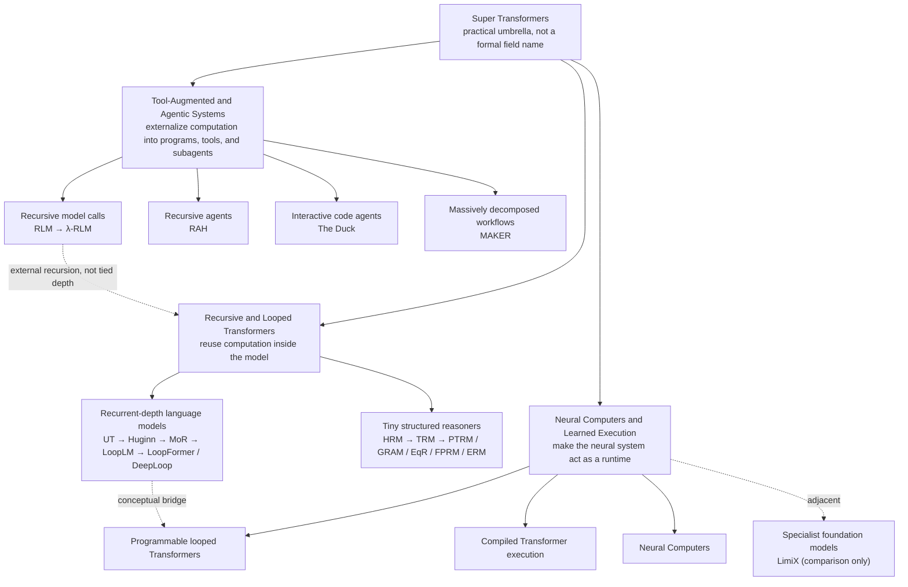
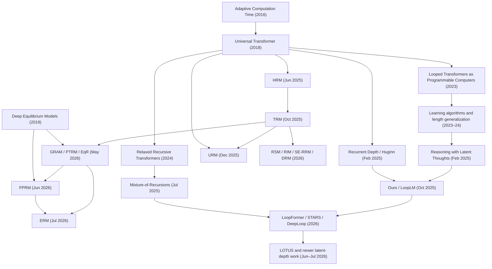

# Super Transformers

## Recursive depth, neural computers, and tool-augmented intelligence

> **How this title is used**
>
> **Super Transformers** is a practical umbrella for this report, not an established academic field name. It covers systems that try to make a Transformer—or a Transformer-centered system—do substantially more than one fixed feed-forward pass by adding **recurrent depth**, **learned execution**, or **external tools and agents**.

> **Executive conclusion**
>
> The cluster remembered as HRM, TRM, RLM, Looped Transformers, Probabilistic TRM, lambda calculus, “General Recursive,” neural computers, and code-writing agents is best divided into three major domains:
>
> 1. **Recursive and Looped Transformers** reuse neural computation internally. This domain contains both tiny structured reasoners and billion-scale recurrent-depth language models.
> 2. **Neural Computers and Learned Execution** aim to turn neural models into programmable or learned runtimes that integrate computation, state, memory, and I/O.
> 3. **Tool-Augmented and Agentic Systems** leave the base network mostly unchanged and extend it with recursive model calls, code execution, environments, voting, and subagents.
>
> **Universal Transformer (2018)** is the first clear Transformer-specific ancestor of the internal-recurrence line. **HRM (2025)** ignited the tiny-model ARC wave, and **TRM (2025)** simplified it into a broader recursive-reasoning family. **Loopie (2026)** adds a distinct fixed layer-local recurrence order and demonstrates operational capacity recycling at MoE scale. **RLM** is a separate external-orchestration line, while **Neural Computers** pursue the different ambition of making a learned model function as the runtime itself.

---

## Contents

- [Part I — Recursive and Looped Transformers](#part-i--recursive-and-looped-transformers)
  - [1. Scope and definitions](#1-scope-and-definitions)
  - [2. The Super Transformer landscape](#2-the-super-transformer-landscape)
  - [3. Technical core of recurrent depth](#3-technical-core-of-recurrent-depth)
  - [4. Research map](#4-research-map)
  - [5. Chronology of recursive and looped Transformers](#5-chronology-of-recursive-and-looped-transformers)
  - [6. Tiny structured reasoners: HRM to TRM and beyond](#6-tiny-structured-reasoners-hrm-to-trm-and-beyond)
  - [7. Recurrent-depth language models](#7-recurrent-depth-language-models)
- [Part II — Neural Computers and Learned Execution](#part-ii--neural-computers-and-learned-execution)
  - [8. Transformers as computers](#8-transformers-as-computers)
  - [9. Neural computers](#9-neural-computers)
  - [10. Compact specialist foundation models](#10-compact-specialist-foundation-models)
- [Part III — Tool-Augmented and Agentic Systems](#part-iii--tool-augmented-and-agentic-systems)
  - [11. Recursive model-call systems](#11-recursive-model-call-systems)
  - [12. Interactive agents and reliable long-horizon workflows](#12-interactive-agents-and-reliable-long-horizon-workflows)
- [Part IV — Benchmarks, Critiques, and Current Status](#part-iv--benchmarks-critiques-and-current-status)
  - [13. ARC-AGI results and evaluation](#13-arc-agi-results-and-evaluation)
  - [14. Critical evidence and negative results](#14-critical-evidence-and-negative-results)
  - [15. Resolving the remembered names](#15-resolving-the-remembered-names)
  - [16. Current status](#16-current-status)
  - [17. What is genuinely unified—and what is not](#17-what-is-genuinely-unifiedand-what-is-not)
  - [18. Compact reading order](#18-compact-reading-order)
  - [19. References](#19-references)

---


## Part I — Recursive and Looped Transformers

### 1. Scope and definitions

There is no universally accepted category called “Super Transformers.” In this report the term is deliberately broad, while the underlying mechanisms remain sharply separated.

The **core recursive-Transformer lineage** includes systems that do at least one of the following:

- reuse a neural transition block across computational depth;
- iteratively refine a persistent latent state or fixed-size answer;
- adapt internal iteration count to the input or compute budget;
- directly extend, analyze, or criticize Universal Transformers, HRM, TRM, or recurrent-depth language models.

The report also covers two additional domains because they pursue the same larger objective—more capable computation around Transformers—but through different mechanisms:

- **neural computers and learned runtimes**, in which the neural system performs or simulates execution;
- **tool-augmented and agentic systems**, in which programs, REPLs, environments, voting, or subagents provide the extra computation.

The following are mentioned only when they directly clarify the map:

- ordinary RNNs and state-space models;
- Transformer-XL-style recurrence used mainly as memory;
- generic chain of thought, self-reflection, tree search, or self-consistency;
- diffusion language models;
- parameter sharing without iterative computation.

The goal is near-exhaustive coverage of the major named foundations and direct descendants, together with a disciplined map of the neural-computer and tool-agent programs that pursue the same broader objective through different mechanisms.

### 2. The Super Transformer landscape

#### 2.1 Three places to add computation

| Domain | Where extra computation lives | Does the base architecture change? | Representative systems |
|---|---|---:|---|
| **Recursive and Looped Transformers** | Inside the model, through shared depth or latent-state refinement | Usually yes | Universal Transformer, Huginn, HRM, TRM, LoopLM, FPRM |
| **Neural Computers and Learned Execution** | In a learned or compiled neural runtime | Yes, or the model is constructed as an executor | Looped programmable Transformers, Percepta executor, Neural Computers |
| **Tool-Augmented and Agentic Systems** | Outside the model, through programs, tools, environments, and subagents | Often no | RLM, λ-RLM, The Duck, MAKER, Recursive Agent Harnesses |

#### 2.2 Two internal-recurrence research programs

Within Recursive and Looped Transformers, two programs should be kept distinct:

**Tiny structured recursive reasoners**

- Typical scale: about 2M–30M parameters.
- Typical tasks: Sudoku, mazes, ARC grids, constraint satisfaction.
- Typical training: from scratch and heavily task-specific.
- Central question: can a small shared transition learn an iterative solver?

**Recurrent-depth language models**

- Typical scale: hundreds of millions to several billion parameters.
- Typical tasks: language modeling, mathematics, in-context learning, and general reasoning.
- Typical training: full pretraining or conversion of pretrained Transformers.
- Central question: can effective depth and inference compute grow without proportional parameter growth?

#### 2.3 At-a-glance chronology across all domains

| Date | Track | Milestone | Why it matters |
|---|---|---|---|
| 2016 | Recursive computation | Adaptive Computation Time | Learned variable compute before Transformers |
| 2018 | Recursive Transformers | Universal Transformer | Shared Transformer transition across depth |
| 2019 | Equilibrium models | Deep Equilibrium Models | Infinite tied depth as a fixed-point solve |
| 2023 | Neural execution | Looped Transformers as Programmable Computers | A looped Transformer emulates an instruction-set computer |
| 2024 | Recurrent-depth LMs | Relaxed Recursive Transformers | Converts pretrained Transformers to shared recursive stacks |
| Feb 2025 | Recurrent-depth LMs | Huginn / recurrent depth | Billion-scale latent test-time compute |
| Jun 2025 | Tiny reasoners | HRM | Starts the small-model ARC wave |
| Sep 2025 | Specialist models | LimiX | Compact structured-data foundation modeling; not recursive depth |
| Oct 2025 | Tiny reasoners | TRM | Simplifies HRM to a 7M-parameter recursive model |
| Oct 2025 | Tool systems | Original RLM blog | External prompt environment plus recursive model calls |
| Oct 2025 | Recurrent-depth LMs | Ouro / LoopLM | Trillion-token looped-LM pretraining |
| Nov 2025 | Agentic workflows | MAKER | Million-step reliability through decomposition and voting |
| Dec 2025 | Tool systems | Formal RLM paper | Establishes recursive model calls as an inference paradigm |
| Mar 2026 | Tool systems | λ-RLM | Typed lambda-calculus control and formal cost bounds |
| Apr 2026 | Neural computers | Neural Computers | Learned runtime state for computation, memory, and I/O |
| May 2026 | Stochastic reasoners | GRAM, PTRM, EqR | Multi-trajectory exploration and attractor reasoning |
| Jun 2026 | Stable recurrence | FPRM and LOTUS | Convergence-based halting and supervised latent reasoning |
| Jul 2026 | Tool agents | The Duck | Interactive ARC-AGI-3 REPL agent |
| Jul 2026 | Stable recurrence | ERM and DeepLoop | Energy-guided selection and depth-aware residual scaling |
| Jul 2026 | Layer-local recurrence | Loop the Loopies! | Fixed R=2 layer-loop ordering plus measured training-capacity recycling |

#### 2.4 High-level map



### 3. Technical core of recurrent depth

#### 3.1 Feed-forward depth versus recurrent depth

A conventional Transformer uses distinct parameters at each depth:

\[
h_{\ell+1}=F_{\theta_\ell}(h_\ell).
\]

A strictly looped Transformer instead uses:

\[
h_{t+1}=F_\theta(h_t).
\]

A model with \(k\) physical layers looped \(L\) times has an effective unrolled depth of approximately \(kL\), while storing only the \(k\) physical layers.

This offers three potential benefits:

1. **Parameter efficiency:** more computation without proportionally more weights.
2. **Test-time compute scaling:** run more loops on harder examples.
3. **Algorithmic inductive bias:** the same update rule is repeatedly applied, resembling an iterative algorithm.

It also creates three major problems:

1. **Optimization and signal propagation:** one shared transition must remain useful over many visits.
2. **Stability:** additional loops may oscillate, diverge, stagnate, or “overthink.”
3. **State capacity:** a small latent workspace may be insufficient even with unlimited depth.

#### 3.2 HRM’s multi-timescale recurrence

HRM introduced two coupled modules:

- \(H\): a slower high-level module;
- \(L\): a faster low-level module.

The biological interpretation was that \(H\) performs abstract planning while \(L\) performs detailed computation. Later analyses found that the hierarchy itself explained less of the performance than the complete training and refinement pipeline.

#### 3.3 TRM’s answer-and-latent recursion

TRM simplified the mechanism to one tiny network operating on:

- input representation \(x\);
- current answer \(y\);
- internal latent state \(z\).

Conceptually:

\[
z \leftarrow f_\theta(x,y,z),
\qquad
y \leftarrow g_\theta(x,y,z).
\]

The transition is repeatedly supervised so that the answer can be refined over several outer steps.

#### 3.4 Deterministic versus stochastic trajectories

Early HRM/TRM-style models usually follow one deterministic path. Later work added breadth:

- **PTRM:** Gaussian noise creates parallel trajectories.
- **GRAM:** learns a probabilistic latent-trajectory model.
- **EqR:** scales both depth and stochastic trajectory breadth.
- **ERM:** uses an explicit energy function to rank and guide candidates.

This progression separates two questions that were initially conflated:

1. How should candidate solutions be **generated**?
2. How should candidate solutions be **selected or verified**?

#### 3.5 Adaptive halting

Different works stop recursion using different mechanisms:

- ACT-style learned halting probability;
- a learned Q/confidence head;
- entropy thresholds;
- a fixed iteration budget;
- convergence of the latent state;
- an external verifier;
- an energy function.

The halting rule is not a minor implementation detail. It determines whether extra test-time compute is useful, wasteful, or actively harmful.

---

### 4. Research map

The diagram below shows the **internal recurrent-depth lineage only**. External tool systems and neural-computer proposals are deliberately excluded from its descent arrows.



### 5. Chronology of recursive and looped Transformers

The chronology below contains the internal-recurrence line. RLM and recursive-agent milestones are moved to Part III so that architectural recurrence is not mixed with external orchestration.

#### 5.1 Foundations: 2016–2024

---

##### March 2016 — Adaptive Computation Time

**Adaptive Computation Time for Recurrent Neural Networks**, by Alex Graves, allowed a recurrent model to learn how many internal steps to use before emitting an output.

Why it matters:

- established learned variable computation;
- influenced later halting heads;
- provided the clearest pre-Transformer ancestor of adaptive recurrent depth.

Source: [arXiv:1603.08983](https://arxiv.org/abs/1603.08983)

---

---

##### July 2018 — Universal Transformer

The **Universal Transformer** repeatedly applied a shared self-attention transition across depth and optionally used per-position adaptive halting.

Why it matters:

- the first major Transformer-specific ancestor;
- explicitly combined self-attention with recurrence over depth;
- showed stronger algorithmic and length-generalization behavior than fixed-depth Transformers in several settings;
- established computational universality under the paper’s assumptions.

Source: [arXiv:1807.03819](https://arxiv.org/abs/1807.03819)

---

---

##### September 2019 — Deep Equilibrium Models

**Deep Equilibrium Models** treated an infinitely deep weight-tied network as the solution to:

\[
h^\*=F_\theta(h^\*,x).
\]

Instead of unrolling every layer, the model solves for the fixed point and differentiates implicitly.

Why it matters:

- supplied a rigorous equilibrium formulation for infinitely deep tied networks;
- introduced constant-memory differentiation with respect to effective depth;
- became a conceptual and technical ancestor of later attractor and fixed-point reasoners.

DEQ is a strong ancestor of the **equilibrium sub-branch**, but it is not an ancestor of every system that happens to use the word recursion.

Source: [arXiv:1909.01377](https://arxiv.org/abs/1909.01377)

---

---

##### January 2023 — Looped Transformers as Programmable Computers

Giannou and colleagues placed a constant-size Transformer in a loop and hand-programmed it to emulate an instruction-set computer.

The constructed model supported:

- memory reads and writes;
- nonlinear operations;
- function calls;
- program counters;
- conditional branches;
- general-purpose iterative programs.

Why it matters:

- made the “small fixed network, arbitrarily extended computation” interpretation explicit;
- demonstrated that loop count can represent program execution depth;
- helped popularize the exact phrase **Looped Transformers**.

Source: [arXiv:2301.13196](https://arxiv.org/abs/2301.13196)

---

---

##### November 2023 — Looped Transformers learn learning algorithms

**Looped Transformers are Better at Learning Learning Algorithms** trained looped models rather than hand-programming them.

The authors reported performance comparable to standard Transformers on data-fitting tasks using less than 10% of the parameter count.

Why it matters:

- shifted the line from expressivity constructions to learned iterative procedures;
- suggested that weight sharing can be an inductive bias for iterative algorithms.

Source: [arXiv:2311.12424](https://arxiv.org/abs/2311.12424)

---

---

##### September 2024 — Length generalization through adaptive loops

**Looped Transformers for Length Generalization** showed that models trained on shorter algorithmic instances could handle longer inputs by running more loops at inference.

Why it matters:

- directly connected test-time recurrence to extrapolation beyond training length;
- strengthened the analogy between loop count and algorithmic step count.

Source: [arXiv:2409.15647](https://arxiv.org/abs/2409.15647)

---

---

##### October 2024 — Relaxed Recursive Transformers

**Relaxed Recursive Transformers: Effective Parameter Sharing with Layer-wise LoRA** converted pretrained Transformers into a single repeated stack, then added small depth-specific LoRA modules to relax perfect weight tying.

Why it matters:

- brought recursive depth into actual pretrained language models;
- separated a shared computational core from lightweight depth-specific adaptation;
- showed a practical model-compression path rather than only from-scratch training;
- introduced continuous depth-wise batching as a possible throughput benefit.

Status: published at **ICLR 2025**.

Source: [arXiv:2410.20672](https://arxiv.org/abs/2410.20672)

---

---

#### 5.2 The 2025 internal-recurrence wave

---

##### February 7, 2025 — Recurrent Depth / Huginn

**Scaling up Test-Time Compute with Latent Reasoning: A Recurrent Depth Approach** trained a 3.5B-parameter model on 800B tokens and iterated a recurrent block to arbitrary depth at inference.

The paper reported improvements up to a compute load comparable to a roughly 50B-parameter feed-forward model.

Why it matters:

- reframed recurrent depth as **latent test-time compute scaling**;
- provided a serious billion-parameter proof of concept;
- separated “thinking longer” from generating more chain-of-thought tokens.

The associated model is commonly called **Huginn**.

Status: presented at **NeurIPS 2025**.

Source: [arXiv:2502.05171](https://arxiv.org/abs/2502.05171)

---

---

##### February 24, 2025 — Reasoning with Latent Thoughts

This work argued theoretically and empirically that a shallow block looped many times can approximate a much deeper untied Transformer on iterative reasoning problems.

It connected loops to latent chains of thought and showed that a looped model can simulate multiple explicit reasoning steps.

Why it matters:

- gave the 2025 wave a cleaner theoretical justification;
- distinguished depth requirements from parameter requirements;
- connected recurrent depth with inference-time scaling laws.

Status: published at **ICLR 2025**.

Source: [arXiv:2502.17416](https://arxiv.org/abs/2502.17416)

---

---

##### June 2025 — Hierarchical Reasoning Model

**Hierarchical Reasoning Model (HRM)** introduced two interdependent recurrent modules operating at different frequencies:

- a slow high-level module;
- a fast low-level module.

The model had roughly 27M parameters and was trained from scratch on structured tasks such as Sudoku, mazes, and ARC.

Why it mattered culturally:

- it combined a striking small-model story with strong puzzle results;
- its approximately 41% public ARC-AGI-1 claim went viral;
- it triggered the direct HRM → TRM → RRM research wave.

###### Date caveat

The current arXiv record lists the first submission on **June 26, 2025**. ARC Prize’s later analysis describes the release as **June 8, 2025**. This chronology uses the verifiable arXiv submission date while noting that an earlier release or announcement may have circulated.

Source: [arXiv:2506.21734](https://arxiv.org/abs/2506.21734)

---

---

##### July 11, 2025 — AbbIE

**AbbIE: Autoregressive Block-Based Iterative Encoder for Efficient Sequence Modeling** proposed a recursive generalization of an encoder-only Transformer.

It trained with as few as two iterations and generalized upward to more iterations at test time.

Why it matters:

- another independent 2025 attempt to make latent iteration a scalable inference axis;
- likely one source of the remembered phrase **“recursive generalization.”**

Source: [arXiv:2507.08567](https://arxiv.org/abs/2507.08567)

---

---

##### July 14, 2025 — Mixture-of-Recursions

**Mixture-of-Recursions (MoR)** combined two efficiency axes:

1. shared parameters across recursive depth;
2. adaptive token-level compute.

Lightweight routers decide which tokens remain active at later recursive steps. Attention is applied only among active tokens, and an optional variant shares KV states.

Why it matters:

- moved beyond one global loop count;
- made recursive depth input- and token-dependent;
- established a practical Pareto frontier at 135M–1.7B scales.

Status: **NeurIPS 2025**.

Source: [arXiv:2507.10524](https://arxiv.org/abs/2507.10524)

---

---

##### October 6, 2025 — Tiny Recursive Model

**Less is More: Recursive Reasoning with Tiny Networks** introduced the **Tiny Recursive Model (TRM)**.

TRM removed HRM’s two-timescale hierarchy and used one tiny two-layer network to repeatedly update the latent state and answer.

Reported highlights:

- roughly 7M parameters;
- 45% on ARC-AGI-1;
- 8% on ARC-AGI-2;
- 87.4% on Sudoku-Extreme;
- simpler architecture than HRM.

Why it matters:

- showed that the hierarchy was not necessary for the reported gains;
- turned the idea into a simpler reusable baseline;
- established “recursive reasoning models” as a recognizable mini-field.

Status: first-place **ARC Prize 2025 Paper Award**; solo-authored by Alexia Jolicoeur-Martineau.

Source: [arXiv:2510.04871](https://arxiv.org/abs/2510.04871)

---

---

##### October 29, 2025 — Ouro / LoopLM

**Scaling Latent Reasoning via Looped Language Models** introduced the open-source **Ouro** family of pretrained Looped Language Models.

Reported scale:

- 1.4B and 2.6B models;
- pretraining on as much as 7.7T tokens;
- entropy-regularized learned depth allocation.

Why it matters:

- one of the strongest attempts to scale looped latent reasoning into general pretraining;
- reported performance comparable to much larger standard LMs;
- provided an institutional and computational bridge from theoretical looped Transformers to serious LLM-scale systems.

Source: [arXiv:2510.25741](https://arxiv.org/abs/2510.25741)

---

---

##### November 2025 — Training and interpretation begin to fragment

Several works started treating TRM less as a singular architecture and more as a template:

- faster training curricula;
- test-time adaptation;
- policy-improvement interpretations;
- alternative supervision schemes.

This is the point where the “TRM lineage” became a broader recursive-reasoning research program rather than one model.

---

---

##### December 4, 2025 — Independent TRM audit

**Tiny Recursive Models on ARC-AGI-1: Inductive Biases, Identity Conditioning, and Test-Time Compute** reported four important findings:

1. The 1,000-sample augmentation-and-voting pipeline improved Pass@1 by **10.75 percentage points** over single canonical inference.
2. Blank or randomized puzzle identity caused accuracy to fall to zero.
3. Most final accuracy appeared at the first recursion, with rapid saturation.
4. Heavy augmentation broadened the candidate distribution and improved multi-sample success.

Why it matters:

- challenged the interpretation that deep internal recursion was the sole source of TRM’s results;
- showed that task identity, augmentation, and aggressive test-time compute were central;
- did not negate TRM’s efficiency, but narrowed the claim from general recursive reasoning to a highly effective task-specific system.

Source: [arXiv:2512.11847](https://arxiv.org/abs/2512.11847)

---

---

##### December 16, 2025 — Universal Reasoning Model

**Universal Reasoning Model (URM)** revisited the Universal Transformer and argued that the main gains came from:

- recurrent inductive bias;
- strong nonlinear Transformer components;
- not elaborate biological hierarchy.

URM added short convolutions and truncated backpropagation through loops.

Reported scores:

- 53.8% pass@1 on ARC-AGI-1;
- 16.0% pass@1 on ARC-AGI-2.

Why it matters:

- reconnected the HRM/TRM wave with the 2018 Universal Transformer lineage;
- reinforced the conclusion that recurrence mattered more than hierarchy.

Source: [arXiv:2512.14693](https://arxiv.org/abs/2512.14693)

---

---

#### 5.3 The 2026 recursive-depth expansion

---

##### January 12 — Tab-TRM

**Tiny Recursive Model for Insurance Pricing on Tabular Data** adapted TRM-style latent refinement to insurance modeling.

Why it matters:

- evidence that the architecture was diffusing beyond puzzles;
- an application branch rather than a core architectural advance.

Source: [arXiv:2601.07675](https://arxiv.org/abs/2601.07675)

---

---

##### January 15 — Mechanistic analysis of HRM

**Are Your Reasoning Models Reasoning or Guessing?** found:

- failures on extremely simple puzzles, including cases with one unknown cell;
- abrupt grokking-like corrections rather than smooth refinement;
- multiple latent fixed points;
- trajectories that could settle on an incorrect attractor.

The authors improved Sudoku performance by scaling the number and quality of “guesses” through augmentation, input perturbation, and model bootstrapping.

Why it matters:

- supplied a mechanistic explanation for both HRM’s strength and brittleness;
- motivated the later stochastic and attractor-based models.

Source: [arXiv:2601.10679](https://arxiv.org/abs/2601.10679)

---

---

##### February 2 — LoopViT

**LoopViT: Scaling Visual ARC with Looped Transformers** used a weight-tied hybrid convolution/attention block and an entropy-based dynamic exit.

Reported result:

- 18M parameters;
- 65.8% ARC-AGI-1 accuracy under the paper’s protocol.

Why it matters:

- pushed the looped visual-reasoning branch beyond HRM/TRM;
- used uncertainty rather than a learned Q head for halting.

This is an author-reported result and should not be treated as directly equivalent to ARC Prize semi-private verification.

Source: [arXiv:2602.02156](https://arxiv.org/abs/2602.02156)

---

---

##### February 11 — LoopFormer

**LoopFormer** trained looped language models on variable-length trajectories and conditioned the loop on time and step size.

The shortcut-consistency objective was designed so that:

- short budgets remain useful;
- longer budgets continue improving;
- one model can operate under several inference budgets.

Why it matters:

- directly targets compute-elastic language models;
- treats recurrent refinement as a controlled trajectory rather than repeated identical steps.

Status: published at **ICLR 2026**.

Source: [arXiv:2602.11451](https://arxiv.org/abs/2602.11451)

---

---

##### February 12 — Mamba-2/TRM hybrid

**Tiny Recursive Reasoning with Mamba-2 Attention Hybrid** replaced parts of the TRM transition with a Mamba-2 hybrid operator at approximately matched parameter count.

The authors reported improved candidate coverage on ARC while preserving top-1 performance.

Why it matters:

- showed that attention is not the only viable operator inside the recursive scaffold;
- widened the design space to state-space/attention hybrids.

Source: [arXiv:2602.12078](https://arxiv.org/abs/2602.12078)

---

---

##### March 2 — Symbol-Equivariant Recurrent Reasoning Models

**SE-RRM** encoded symbol and color permutation symmetry directly into the architecture.

Reported benefits included:

- substantially less augmentation;
- about 2M parameters;
- extrapolation from 9×9 Sudoku to 4×4, 16×16, and 25×25 variants.

Why it matters:

- replaced brute-force learned invariance with an architectural guarantee;
- showed that some RRM success can be strengthened through explicit task structure.

Source: [arXiv:2603.02193](https://arxiv.org/abs/2603.02193)

---

---

##### March 3 — Recursive Stem Model

**Form Follows Function: Recursive Stem Model (RSM)** retained a TRM-like backbone but changed the training contract:

- detach early warm-up iterations;
- supervise only the final step;
- independently vary outer and inner recursion;
- train a depth-agnostic transition.

The paper reported:

- more than 20× faster training than TRM in its setup;
- test-time execution far deeper than training;
- 97.5% Sudoku-Extreme accuracy with additional compute.

Why it matters:

- shifts attention from architecture to how the transition operator is trained;
- attempts true train-shallow, infer-deep behavior.

Source: [arXiv:2603.15641](https://arxiv.org/abs/2603.15641)

---

---

##### March 5 — Recursive Inference Machines

**Recursive Inference Machines (RIMs)** generalized TRM into a framework consisting of:

- state and answer initialization;
- a solver;
- a recursive transition;
- a reweighting mechanism.

Why it matters:

- casts TRM as one member of a broader neural-inference-machine class;
- connects the new neural reasoners to classical iterative inference systems;
- extends the method to ARC, Sudoku, and tabular classification.

Source: [arXiv:2603.05234](https://arxiv.org/abs/2603.05234)

---

---

##### March 9 — Negative result for autoregressive TRM

**Tiny Autoregressive Recursive Models** conducted controlled, compute-matched experiments that gradually transformed a standard Transformer into an autoregressive TRM.

Main result:

- some simpler two-level refinement baselines helped;
- the complete autoregressive TRM architecture showed no reliable advantage.

Why it matters:

- cautions against assuming that success on fixed-format puzzles transfers to next-token language modeling;
- is one of the clearest negative results in the field.

Source: [arXiv:2603.08082](https://arxiv.org/abs/2603.08082)

---

---

##### April 9 — Loop, Think, & Generalize

This study examined systematic composition and depth extrapolation in recurrent-depth Transformers.

Findings included:

- recurrent depth can improve systematic generalization;
- more inference loops can unlock deeper reasoning;
- excessive recurrence can produce **overthinking**, eventually degrading performance.

Why it matters:

- reinforces both the promise and the central stability problem;
- provides controlled evidence rather than only benchmark-scale claims.

Source: [arXiv:2604.07822](https://arxiv.org/abs/2604.07822)

---

---

##### April 20 — Denoising Recursion Models

**One Step Forward and K Steps Back: Better Reasoning with Denoising Recursion Models (DRM)** corrupted target solutions and trained the model to reverse the corruption over several recursive steps.

Why it matters:

- supplies a curriculum of meaningful intermediate states;
- aligns training-time trajectories with iterative inference;
- combines recursion with ideas from denoising and diffusion without becoming an ordinary diffusion LM.

Source: [arXiv:2604.18839](https://arxiv.org/abs/2604.18839)

---

---

##### April 23 — Universal Transformers need memory

**Universal Transformers Need Memory: Depth-State Trade-offs in Adaptive Recursive Reasoning** studied learned memory tokens as a scratchpad.

A central finding was that, in its Sudoku setting, extra loop depth alone did not produce nontrivial performance without sufficient memory tokens.

Why it matters:

- identifies a depth–state-capacity tradeoff;
- demonstrates that “just run more loops” is not a complete scaling strategy.

Source: [arXiv:2604.21999](https://arxiv.org/abs/2604.21999)

---

---

##### May 12 — Attractor Models

**Solve the Loop: Attractor Models for Language and Reasoning** separated:

- a backbone that proposes an initial embedding;
- an attractor module that refines it by solving for a fixed point.

The model used implicit differentiation, reconnecting the modern looped-model wave to DEQ.

Why it matters:

- supports adaptive iteration by convergence;
- aims to make effective depth memory-efficient;
- reports results in both language pretraining and tiny structured reasoning.

Source: [arXiv:2605.12466](https://arxiv.org/abs/2605.12466)

---

---

##### May 19 — Generative Recursive Reasoning / GRAM

**Generative Recursive reAsoning Models (GRAM)** made recursive latent reasoning probabilistic.

Instead of one deterministic trajectory, GRAM learns a distribution over trajectories using amortized variational inference. A Latent Process Reward Model can rank sampled trajectories, creating two inference-time scaling axes:

- **depth:** more recursive refinement;
- **width:** more independently sampled trajectories.

Reported results for the approximately 10.9M-parameter model include:

- 97.0% on Sudoku-Extreme, versus 87.4% for the cited TRM baseline;
- 52.0% on ARC-AGI-1;
- 11.1% on ARC-AGI-2;
- 99.7% valid-solution accuracy and 90.3% solution coverage on the studied N-Queens setting;
- 99.05% validity when generating complete Sudoku boards unconditionally from an empty input.

Why it matters:

- enables multiple hypotheses and solution strategies;
- scales inference through both depth and trajectory count;
- supports conditional reasoning $p(y \mid x)$ and unconditional generation $p(x)$;
- demonstrates that stochasticity can address both false attractors and deterministic mode collapse on multi-solution tasks.

These are author-reported paper/project results and inherit the same ARC protocol-comparability caveats discussed later.

This is the strongest match for the fuzzy memory **“General Recursive.”**

Sources: [arXiv:2605.19376](https://arxiv.org/abs/2605.19376); [GRAM project page](https://ahn-ml.github.io/gram-website/)

---

---

##### May 19 — Probabilistic Tiny Recursive Model

**Probabilistic TRM (PTRM)** injected Gaussian noise at deep recursive steps, produced parallel trajectories, and selected among them with the existing TRM Q head.

Reported improvements:

- Sudoku-Extreme: 87.4% → 98.75%;
- Pencil Puzzle Bench: 62.6% → 91.2%;
- no retraining required.

Why it matters:

- directly attacks deterministic false attractors;
- cleanly separates stochastic exploration from the base model;
- confirms the remembered name **“Probabilistic TRM.”**

Source: [arXiv:2605.19943](https://arxiv.org/abs/2605.19943)

---

---

##### May 20 — Equilibrium Reasoners

**Equilibrium Reasoners: Learning Attractors Enables Scalable Reasoning (EqR)** interpreted generalizable recursive reasoning as convergence toward task-conditioned solution attractors.

EqR scales inference along two axes:

- **depth:** more iterations;
- **breadth:** more stochastic initializations or trajectories.

The authors reported scaling to unrolled computation equivalent to tens of thousands of layers and over 99% on Sudoku-Extreme in their setup.

Why it matters:

- gives the attractor interpretation its most explicit modern form;
- provides the direct precursor used by later energy-guided selection work.

Source: [arXiv:2605.21488](https://arxiv.org/abs/2605.21488)

---

---

##### May 21 — HRM-Text

**HRM-Text: Efficient Pretraining Beyond Scaling** attempted to carry HRM’s slow/fast hierarchy into a roughly 1B-parameter text model.

It introduced:

- MagicNorm;
- warm-up deep credit assignment;
- instruction-response training with PrefixLM masking.

Why it matters:

- the most direct attempt by the HRM line to escape fixed-format puzzles;
- provides an “existence proof” claim for data- and compute-efficient language-model training;
- remains author-reported and requires broader independent comparison.

Source: [arXiv:2605.20613](https://arxiv.org/abs/2605.20613)

---

---

##### May 22 — LT²: Linear-Time Looped Transformers

**LT²** explored linear-time sequence processing inside looped Transformers.

Why it matters:

- addresses the fact that recurrence multiplies the cost of each block;
- represents the efficiency-engineering branch of the field.

Source: [arXiv:2605.20670](https://arxiv.org/abs/2605.20670)

---

---

##### May 26 — STARS

**Stabilizing Recurrent Dynamics for Test-Time Scalable Latent Reasoning in Looped Language Models** observed that performance may peak and then collapse as loop count increases.

STARS regularizes the recurrent Jacobian’s spectral radius to encourage asymptotically stable fixed points.

Why it matters:

- makes stability an explicit training objective;
- provides a formal response to “overthinking” and deep-loop collapse.

Source: [arXiv:2605.26733](https://arxiv.org/abs/2605.26733)

---

---

##### June 16 — Fixed-Point Reasoners

**Fixed-Point Reasoners: Stable and Adaptive Deep Looped Transformers** introduced the Fixed-Point Reasoning Model (FPRM).

Key changes:

- pre-normalization;
- residual scaling;
- convergence itself as the halting criterion.

Why it matters:

- directly addresses signal propagation at large recurrent depth;
- removes the need for a separately trained Q/ACT head;
- unifies Universal-Transformer recurrence with DEQ-style convergence more legitimately than the vague claim that all recursion is the same.

Source: [arXiv:2606.18206](https://arxiv.org/abs/2606.18206)

---

---

##### June 30 — LOTUS

**Bridging the Gap Between Latent and Explicit Reasoning with Looped Transformers** introduced LOTUS, which supervises parallel latent positions using gold chain-of-thought steps.

Reported contributions:

- closes the latent-versus-explicit CoT gap at 3B scale in the studied setting;
- reduces thought-phase latency by 2.5×–6.9×;
- makes post-loop latent positions partially interpretable through the LM head.

Why it matters:

- directly connects looped latent depth with explicit reasoning supervision;
- addresses a major weakness of unsupervised or weakly supervised latent reasoning.

Source: [arXiv:2606.31779](https://arxiv.org/abs/2606.31779)

---

---

##### July 11 — Energy-guided Recursive Model

**Energy-guided Recursive Model (ERM)** used explicit Hopfield-style energy functions to rank and guide candidate solutions.

Reported results with 64 recurrent steps and 128 candidates:

- Sudoku: 98.97%;
- Pencil Puzzle Bench: 88.04%;
- maze: 99.30%.

Why it matters:

- supplies a principled selector rather than only voting or a learned Q head;
- combines recursive reasoning with energy-based sampling and parallel tempering;
- marks the progression from deterministic refinement to stochastic generation to constraint-aware selection.

Source: [arXiv:2607.10128](https://arxiv.org/abs/2607.10128)

---

---

##### July 12 — LayerNorm as implicit gain control

**LayerNorm as Implicit Gain Control in Looped Transformers** analyzed how normalization regulates repeated application of one shared block.

Why it matters:

- reflects the field’s shift from inventing new acronyms to understanding recurrent dynamics;
- supports the view that normalization and residual scaling are central to deep-loop stability.

Source: [arXiv:2607.10681](https://arxiv.org/abs/2607.10681)

---

---

##### July 15 — DeepLoop

**DeepLoop: Depth Scaling for Looped Transformers** derived residual-scaling rules that explicitly account for repeated visits to the same parameters.

The paper argues that standard DeepNorm scaling depends only on nominal layer count and does not fully capture tied-depth recurrence.

Why it matters:

- the latest clearly central looped-Transformer paper located as of July 17, 2026;
- further confirms that stable training, not the basic idea of looping, is now a primary frontier;
- corrects the earlier impression that ERM on July 11 was the newest core paper.

Source: [arXiv:2607.13491](https://arxiv.org/abs/2607.13491)

---

---

##### July 17 — Temporal Middle-Layer Recurrence: adjacent, not the same axis

**T²MLR: Transformer with Temporal Middle-Layer Recurrence** appeared on July 17.

It carries a later-layer representation from one generated token into an earlier middle layer for the next token. This is recurrence **across autoregressive time**, not repeated depth computation for the same token.

Why it belongs in the map but outside the core chronology:

- it is part of the broader rediscovery of continuous recurrent state in Transformers;
- it explicitly compares itself with looped depth;
- its recurrence axis and inference-cost profile differ materially from HRM/TRM and LoopLM.

Source: [arXiv:2607.15178](https://arxiv.org/abs/2607.15178)

---

### 6. Tiny structured reasoners: HRM to TRM and beyond

#### 6.1 What HRM actually contributed

HRM’s novel package consisted of:

- a slow recurrent module;
- a fast recurrent module;
- an outer answer-refinement loop;
- a learned continue/stop score;
- heavy augmentation and task-conditioned training.

Its scientific impact came less from proving a particular brain analogy and more from demonstrating that a small network could perform many recurrent updates over a structured output.

#### 6.2 What TRM simplified

TRM removed the high/low hierarchy and showed that:

- one tiny network was sufficient;
- recursive answer refinement could be expressed with \(y\) and \(z\);
- deep supervision could train the process;
- parameter count could be reduced from approximately 27M to 7M.

This was the decisive simplification. It made it plausible to treat HRM not as one biologically inspired curiosity, but as an instance of a general recursive-reasoner template.

#### 6.3 What the offshoots changed

| Work | Main change |
|---|---|
| URM | Returns to Universal Transformer-style recurrence; adds convolution and truncated BPTT |
| RSM | Changes the training contract; final-step supervision and detached warm-up |
| RIM | Generalizes TRM into an inference-machine framework |
| SE-RRM | Encodes symbol permutation symmetry directly |
| DRM | Trains trajectories through multi-step denoising |
| PTRM | Adds stochastic trajectory exploration without retraining |
| GRAM | Learns a generative distribution over latent trajectories |
| EqR | Frames reasoning as convergence to learned attractors |
| FPRM | Stabilizes deep loops and halts on fixed-point convergence |
| ERM | Adds explicit energy-based candidate selection |

The conceptual evolution is:

```text
HRM hierarchy
    ↓ simplification
TRM deterministic refinement
    ↓ better training / structure
RSM, RIM, SE-RRM, DRM
    ↓ stochastic breadth
PTRM, GRAM, EqR
    ↓ convergence and selection
FPRM, ERM
```

---

### 7. Recurrent-depth language models

This line is older and more continuous than the HRM/TRM puzzle wave.

#### 7.1 The core sequence

```text
Universal Transformer
    → programmable looped Transformers
    → learned algorithms and length generalization
    → Relaxed Recursive Transformers
    → Huginn / recurrent depth
    → Mixture-of-Recursions
    → Ouro / LoopLM
    → LoopFormer, STARS, LOTUS, DeepLoop
```

#### 7.2 Its goals differ from TRM

The LLM-scale branch asks:

- Can one pretrained block substitute for several unique layers?
- Can additional inference compute improve reasoning without adding CoT tokens?
- Can different tokens receive different recursive depth?
- Can a single checkpoint operate at several compute budgets?
- How many unique parameters is one recurrence “worth”?
- How can loop dynamics remain stable beyond the training depth?
- Can latent reasoning match explicit chain of thought?

The small structured branch asks:

- Can a tiny network learn a solver for one task family?
- Can repeated updates reach a valid grid or constraint assignment?
- How should trajectories be sampled and verified?

The common mechanism is real, but the datasets, scaling regimes, and standards of evidence differ.

#### 7.3 Why this is currently the more mature architectural branch

Evidence of maturity includes:

- peer-reviewed work at ICLR and NeurIPS;
- billion-parameter pretraining experiments;
- explicit scaling laws and compute matching;
- routing, elastic budgets, normalization, residual scaling, memory, and KV-cache research;
- movement into vision, speech, and other modalities.

It is still not established that looped LMs are a general replacement for standard Transformers. The strongest conclusion is that recurrence is now a credible additional scaling axis alongside parameters, data, context length, and generated test-time tokens.

---

## Part II — Neural Computers and Learned Execution

This part covers systems that aim to make a Transformer or neural model behave as a computer or runtime. Some share ancestry with looped Transformers, but they should not all be treated as recursive reasoning models.

### 8. Transformers as computers

“Transformer as computer” refers to two substantially different ideas in this landscape.

#### 8.1 Learned or programmed looped execution

The 2023 **Looped Transformers as Programmable Computers** construction uses a looped Transformer to emulate an instruction-set computer. This is already part of the core chronology because repeated depth is the execution axis.

#### 8.2 Compiled deterministic execution

In March 2026, Percepta published a technical blog titled **Can LLMs Be Computers?** It claims to encode arbitrary C programs as execution traces inside a Transformer and to accelerate memory lookup using two-dimensional attention heads and logarithmic-time geometric queries.

The claimed system differs from learned looped reasoners:

- the computational mechanism is described as compiled or constructed rather than learned from puzzle data;
- the objective is deterministic program execution over millions of steps;
- the model acts as an execution engine rather than discovering a latent reasoning procedure.

Status caveat:

- as of July 21, 2026, this item is a technical blog claim;
- no corresponding peer-reviewed paper or official public implementation was located for this synthesis;
- it belongs in the map as a provocative adjacent development, not as established evidence equivalent to the cited papers.

Source: [Percepta — Can LLMs Be Computers?](https://www.percepta.ai/blog/can-llms-be-computers)

The first is part of the recursive-depth lineage because repeated application of the same Transformer block is the execution axis. The second is a compiled or constructed execution program and should be evaluated more like a neural emulator than a learned reasoner.

### 9. Neural computers

#### 9.1 A learned runtime rather than a deeper Transformer

Published on April 7, 2026, **Neural Computers** proposes a broader machine form in which computation, memory, and I/O are unified inside a learned runtime state.

The initial experiments instantiate Neural Computers as **open-loop** video models that roll out CLI or GUI screen states from:

- instructions;
- pixels;
- user actions.

The authors report early success on I/O alignment and short-horizon control, while identifying routine reuse, controlled updating, symbolic stability, and unbounded effective memory as open problems. Roughly half of arithmetic training captions contain the correct answer, and the paper cautions that reprompting may provide hints or outsource work to a text system; these are leakage/roadmap caveats, not measured evidence of a closed-loop reusable neural RAM.

Why it is relevant:

- it pushes the same long-term aspiration as programmable or looped Transformers: the neural model becomes the runtime rather than merely calling one;
- stable execution and reusable routines overlap with concerns in recurrent-depth models.

Why it remains separate:

- the demonstrated architecture is a video-model runtime, not a shared-depth reasoning Transformer;
- the paper proposes a research frontier rather than a direct HRM/TRM/LoopLM continuation.

Source: [arXiv:2604.06425](https://arxiv.org/abs/2604.06425)

The Neural Computer program is broader than “a Transformer with more loops.” Its target is a machine form in which computation, persistent state, memory, and interface behavior are jointly represented and learned; the paper's current video prototype does not yet demonstrate that complete target.

### 10. Compact specialist foundation models

#### 10.1 LimiX: included for comparison, not lineage

First submitted on September 3, 2025, **LimiX** is a foundation-style model for tabular and structured data. It treats structured datasets as joint distributions over variables and missingness and supports tasks such as:

- classification;
- regression;
- missing-value imputation;
- data generation;
- training-free adaptation to new datasets through context-conditioned prediction.

Why it appears in the same notes:

- LimiX-16M and LimiX-2M reinforce the broader 2025–26 pattern that compact specialist models can outperform much larger general LLMs on the domain they are designed for;
- it operates over highly structured inputs, as do many HRM/TRM benchmarks.

Why it is outside this family:

- it does not derive its capability from recursive latent refinement or repeated shared depth;
- it is a structured-data foundation model, not a recursive reasoning model.

Source: [arXiv:2509.03505](https://arxiv.org/abs/2509.03505)

LimiX is retained because it helps explain a recurring pattern in the Super Transformer era: small, domain-shaped foundation models can outperform much larger general LLMs in the regime for which they were designed. It is not evidence for recursive depth or neural execution.

## Part III — Tool-Augmented and Agentic Systems

These systems extend capability outside the neural forward pass. Their central objects are programs, recursive calls, tool interfaces, environments, subagents, and error-correction procedures.

### 11. Recursive model-call systems

#### 11.1 Chronology

| Date | Development | Main contribution |
|---|---|---|
| October 15, 2025 | Original RLM blog | Long prompt as an external environment; model writes code and makes sub-calls |
| December 31, 2025 | Formal RLM paper | General inference paradigm and post-trained RLM-Qwen3-8B |
| January 1, 2026 | Prime Intellect RLMEnv | Early public implementation and RL-environment direction |
| March 2, 2026 | Recursive Models for Long-Horizon Reasoning | Recursive training and active-context theory |
| March 7, 2026 | RLM meets uncertainty / SRLM | Shows search and uncertainty can matter more than recursion itself |
| March 20, 2026 | λ-RLM | Typed functional recursion, termination guarantees, and cost bounds |
| June 11, 2026 | Recursive Agent Harnesses | Recurses over complete tool-using coding agents |

#### 11.2 RLM is an inference strategy, not a new Transformer layer

In RLM, the base LLM can remain unchanged. The system:

1. stores a long input externally;
2. lets the model write code to inspect it;
3. decomposes it;
4. calls a model recursively on selected pieces;
5. combines the results.

This is conceptually closer to a recursive program or divide-and-conquer agent than to a Universal Transformer.

#### 11.3 What the current RLM evidence actually shows

The current RLM paper is stronger than the original December 2025 abstract in two ways.

First, the v3 evaluation reports substantial gains on information-dense long-context tasks. The most dramatic case is OOLONG-Pairs, where GPT-5’s base score is near zero while the GPT-5 RLM reaches 58.00 F1 under the authors’ protocol.

Second, RLM is no longer only a wrapper around a frozen frontier model. The authors post-trained **RLM-Qwen3-8B** around the scaffold and report a 28.3% average improvement over Qwen3-8B.

The evidence also narrows the claim:

- a REPL with no recursive sub-calls sometimes matches or beats the full RLM on retrieval- or code-oriented tasks;
- recursive sub-calls help most clearly when nearly every part of the input requires semantic transformation;
- short or simple contexts may be better handled by the base model;
- median costs can be reasonable while pathological trajectories are much more expensive.

Thus the experimentally supported object is a combination of **externalized context, programmatic access, decomposition, selective sub-calling, and model capability**—not recursion in isolation.

#### 11.4 What λ-RLM changed

Standard RLM allows arbitrary code generation in a REPL. This is flexible but hard to analyze.

λ-RLM constrains control to typed, verified combinators. That enables:

- bounded leaf contexts;
- explicit control flow;
- termination proofs under the framework;
- closed-form cost accounting;
- less brittle execution.

#### 11.5 What Recursive Agent Harnesses changed

RAH makes the recursive unit an entire agent rather than one model call.

A child can possess:

- tools;
- a filesystem;
- a planning loop;
- its own subagents.

This is a systems architecture. Its success depends on decomposition, execution, context management, and aggregation—not on shared latent neural depth.

#### 11.6 The major caveat

Early follow-up work already indicates that:

- recursion is not always beneficial;
- program search and uncertainty-aware selection can matter more than recursion itself;
- extra recursive calls can degrade performance when the problem already fits comfortably in context;
- base models are not necessarily trained to use the harness well.

This mirrors the HRM/TRM story: the entire outer procedure often matters more than the word “recursive.”

#### 11.7 Detailed external-recursion milestones

The following entries preserve the detailed chronology and source notes from the full research timeline.

##### October 15, 2025 — The original RLM blog

Alex Zhang published **Recursive Language Models** as a blog post before the formal paper.

The proposed inference strategy:

- stores a long prompt as an external variable;
- gives the model a Python REPL;
- lets it inspect, slice, transform, and recursively call language models on parts of the prompt.

Why it matters:

- establishes the actual public prehistory of RLM;
- marks the beginning of the separate external-recursion branch;
- explains why “RLM” should not be placed as a direct architectural descendant of TRM.

Source: [Alex Zhang’s RLM blog](https://alexzhang13.github.io/blog/2025/rlm/)

---

---

##### December 31, 2025 — Formal Recursive Language Models paper

The formal **Recursive Language Models** paper generalized the October blog into an inference paradigm for effective input and output lengths far beyond the base model’s nominal context.

The paper reported successful processing of prompts up to two orders of magnitude beyond model context windows. Its current **v3**, revised May 11, 2026, also reports:

- median GPT-5-based RLM improvements of 26% over compaction, 130% over CodeAct with sub-calls, and 13% over Claude Code across the evaluated tasks;
- a post-trained **RLM-Qwen3-8B** model that improves on the underlying Qwen3-8B by 28.3% on average;
- GPT-5 RLM scores of 91.33 on BrowseComp-Plus, 56.50 on OOLONG, and 58.00 F1 on OOLONG-Pairs under the paper’s setup.

Representative results from the paper:

| Method | BrowseComp+ (6M–11M tokens) | OOLONG (131K) | OOLONG-Pairs (32K) |
|---|---:|---:|---:|
| GPT-5 base | Did not fit | 44.00 | 0.04 |
| GPT-5 RLM | 91.33 | 56.50 | 58.00 |
| GPT-5 RLM without sub-calls | 88.00 | 36.00 | 43.93 |

The ablation is important: simply externalizing the prompt into a REPL can be highly effective, while recursive sub-calls add their clearest value on information-dense tasks. RLM costs were comparable at the median but had a long, expensive tail because trajectory lengths varied substantially.

Why it matters:

- formalized external recursive context interaction;
- made recursive model calls a research object rather than an informal agent pattern;
- showed both inference-time scaffolding and small-scale post-training around the scaffold;
- launched a separate sequence of reproduction, search, functional-runtime, and agent-harness work.

Source: [arXiv:2512.24601, current v3](https://arxiv.org/abs/2512.24601)

---

---

##### January 1, 2026 — Prime Intellect RLMEnv

Prime Intellect published an experimental RLM implementation inside its environment framework.

Important caveats from its own report:

- the initial implementation used recursion depth exactly one;
- RLM did not improve every benchmark;
- the authors positioned it as an experimental scaffold and a future RL-training direction.

This is better described as **implementation and exploration**, not mature productization.

Source: [Prime Intellect: Recursive Language Models](https://www.primeintellect.ai/blog/rlm)

---

---

##### March 2 — Recursive Models for Long-Horizon Reasoning

This belongs to the external model-call branch.

The work defined a model that recursively invokes itself in isolated contexts and argued that computable problems can admit decompositions with exponentially smaller active-context requirements.

Experiments included recursively trained reasoning on Boolean satisfiability.

Why it matters:

- provides a theoretical long-horizon rationale for model-call recursion;
- moves beyond RLM as a prompt-handling trick toward recursively trained models.

Source: [arXiv:2603.02112](https://arxiv.org/abs/2603.02112)

---

---

##### March 7 — RLM meets uncertainty / SRLM

**Recursive Language Models Meet Uncertainty** argued that recursion itself was not always the main driver of RLM performance.

Its self-reflective program-search framework used signals such as:

- self-consistency;
- reasoning length;
- verbalized confidence.

The authors reported improvements over RLM under matched time budgets and found that recursion could degrade performance when the full context already fit in the base model’s window.

Why it matters:

- an important early critique inside the RLM branch;
- mirrors the HRM/TRM lesson that the surrounding search and selection procedure may matter more than the recursive label.

Source: [arXiv:2603.15653](https://arxiv.org/abs/2603.15653)

---

---

##### March 20 — λ-RLM and the Y-combinator

**The Y-Combinator for LLMs: Solving Long-Context Rot with λ-Calculus** replaced RLM’s free-form Python control generation with:

- a typed functional runtime;
- a library of preverified combinators;
- bounded neural calls at leaf subproblems.

Reported results:

- λ-RLM beat standard RLM in 29 of 36 model-task comparisons;
- average accuracy gains up to 21.9 points in some model tiers;
- latency reductions up to 4.1×;
- formal termination and cost guarantees under the system’s assumptions.

Why it matters:

- this is almost certainly the remembered **“lambda calculus”** work;
- formalizes the control plane of recursive model calls;
- does not alter the internal Transformer architecture.

Source: [arXiv:2603.20105](https://arxiv.org/abs/2603.20105)

---

---

##### June 11 — Recursive Agent Harnesses

**Recursive Agent Harnesses (RAH)** changed the recursive unit from a bare model call to a complete coding-agent harness with:

- filesystem access;
- code execution;
- planning;
- parallel subagents.

Reported result:

- GPT-5 coding-agent baseline: 71.75% → 81.36% on Oolong-Synthetic under the paper’s setup.

Why it matters:

- extends RLM from model recursion to harness recursion;
- reflects a real pattern in coding-agent systems;
- further separates this branch from internal looped Transformers.

Source: [arXiv:2606.13643](https://arxiv.org/abs/2606.13643)

---

### 12. Interactive agents and reliable long-horizon workflows

#### 12.1 Tufa Labs’ “The Duck”

On July 6, 2026, ARC Prize announced **The Duck** as the first-place solution for ARC-AGI-3 Milestone Prize #1, covering submissions through June 30.

The system:

- runs a local Qwen 3.6 27B FP8 model;
- converts game state into images, ASCII grids, and Python-accessible variables;
- lets the model reason, write helper code, execute it in a live REPL, act, observe the result, and repeat;
- evicts old messages to continue playing without exhausting the context window;
- reportedly benefited from a lightweight generic harness, with hand-crafted tools sometimes reducing performance.

Why it is relevant:

- it is a concrete example of programmatic reasoning and tool use on an interactive ARC benchmark;
- it resembles RLM’s “model plus REPL” interface and the broader coding-agent branch;
- it is a successor in spirit to Tufa Labs’ earlier **Stochastic Goose**.

Why it is not a recursive or looped Transformer:

- the official description does not establish recursive self-calls;
- it does not reuse a neural block over latent depth;
- its recurrence is the ordinary environment interaction loop: observe → code → act → observe.

Source: [ARC Prize 2026 Milestone #1](https://arcprize.org/blog/arc-prize-2026-milestone-1)

#### 12.2 MAKER

On November 12, 2025, **Solving a Million-Step LLM Task with Zero Errors** introduced **MAKER**, a massively decomposed agentic process.

Its strategy is:

1. decompose a long task into extremely small subtasks;
2. assign focused microagents to each subtask;
3. apply an efficient multi-agent voting rule at every step;
4. use modularity to prevent local errors from compounding across the full horizon.

The paper reports completing a benchmark task containing more than one million LLM-mediated steps with zero errors.

Why it is relevant:

- it addresses the same broad question as RLM and recursive agents: how to extend useful computation far beyond one model call;
- it treats reliable orchestration and error correction as alternatives to making the base model intrinsically more capable;
- it is an important counterpoint to latent recurrence: depth can be externalized into a large process graph.

Why it is not a direct RLM descendant:

- the defining idea is massive decomposition and repeated voting, not long-context REPL interaction;
- the worker microagents need not recursively call themselves;
- the million-step claim is demonstrated on a particular decomposable benchmark and should not be generalized to arbitrary organizational tasks.

Source: [arXiv:2511.09030](https://arxiv.org/abs/2511.09030)

#### 12.3 Classification rule

Classify each system by **where its extra computation lives**:

- **Inside the neural model:** repeated shared layers, latent-state refinement, or convergence dynamics belong in **Recursive and Looped Transformers**. Examples: HRM, TRM, LoopLM, and FPRM.
- **In the neural system as an execution substrate:** compiled execution or a learned runtime belongs in **Neural Computers and Learned Execution**. Examples: Percepta’s proposed executor and Neural Computers.
- **Outside the forward pass:** programs, REPLs, tools, environments, voting, or subagents belong in **Tool-Augmented and Agentic Systems**. Examples: RLM, λ-RLM, Recursive Agent Harnesses, The Duck, and MAKER.
- **In domain-shaped pretraining without any of the above mechanisms:** compact specialist foundation models are comparisons rather than descendants. LimiX is the principal example here.

This rule preserves the broader **Super Transformers** umbrella without inventing one false architectural lineage.

## Part IV — Benchmarks, Critiques, and Current Status

### 13. ARC-AGI results and evaluation

#### 13.1 Headline results

| System | Approximate size | Reported ARC result | Evaluation qualification |
|---|---:|---|---|
| HRM paper | 27M | ~41% ARC-AGI-1 public | Paper/public protocol |
| HRM ARC Prize verification | 27M | 32% ARC-AGI-1; 2% ARC-AGI-2 | Semi-private independent verification |
| TRM | ~7M | ~45% ARC-AGI-1; ~8% ARC-AGI-2 | Paper/public protocol with augmentation and sampling |
| GRAM | ~10.9M | 52.0% ARC-AGI-1; 11.1% ARC-AGI-2 | Author-reported; stochastic trajectory sampling |
| URM | varies by setup | 53.8% ARC-AGI-1; 16.0% ARC-AGI-2 pass@1 | Author-reported |
| LoopViT | 18M | 65.8% ARC-AGI-1 | Author-reported public/protocol result |
| NVARC | ensemble | 24.03% private ARC-AGI-2 | Competition system containing TRM-based components; not pure TRM |

#### 13.2 The result most likely remembered

The “small model scores high on ARC-AGI” memory most likely refers to one of:

1. **HRM:** approximately 27M parameters and a 41% public ARC-AGI-1 claim;
2. **TRM:** approximately 7M parameters and a 45% ARC-AGI-1 claim;
3. **GRAM:** approximately 10.9M parameters and a later 52.0% ARC-AGI-1 claim;
4. **LoopViT:** approximately 18M parameters and a later 65.8% author-reported result.

HRM is the one that produced the mid-2025 viral moment. TRM is the one that most strongly established the “tiny recursive model” narrative.

#### 13.3 Why the numbers are not directly comparable

ARC results can differ according to:

- public, semi-private, or private tasks;
- ARC-AGI-1 versus ARC-AGI-2;
- pass@1, pass@2, or pass@k;
- one prediction versus hundreds or thousands of candidates;
- augmentation and de-augmentation;
- majority voting;
- learned Q-head or energy-based selection;
- test-time training;
- task identity embeddings;
- competition compute and time limits;
- whether a result is independently verified.

A number such as “65.8% ARC” is therefore incomplete without the dataset, protocol, candidate budget, and verification status.

#### 13.4 ARC Prize’s HRM findings

ARC Prize independently reported:

- 32% on ARC-AGI-1 semi-private;
- 2% on ARC-AGI-2 semi-private;
- minimal impact from the proposed hierarchy relative to a similarly sized Transformer;
- substantial importance of the outer refinement loop;
- limited cross-task transfer;
- critical importance of task augmentation.

Source: [The Hidden Drivers of HRM’s Performance](https://arcprize.org/blog/hrm-analysis)

#### 13.5 ARC Prize’s TRM recognition

TRM received the first-place 2025 paper award. ARC Prize summarized its results as approximately:

- 45% ARC-AGI-1;
- 8% ARC-AGI-2;
- 7M parameters.

The winning NVARC competition system scored 24.03% on the private ARC-AGI-2 set, but it was an ensemble that included improved test-time-trained and TRM-related components rather than a direct TRM checkpoint.

Source: [ARC Prize 2025 Results and Analysis](https://arcprize.org/blog/arc-prize-2025-results-analysis)

#### 13.6 ARC-AGI-3 is a different benchmark

The Duck’s 2026 milestone win should not be added to the ARC-AGI-1/2 score table.

ARC-AGI-3 is an **interactive reasoning benchmark** involving exploration, environment modeling, goal discovery, planning, action, and correction over time. A winning ARC-AGI-3 agent can therefore be important to the broader reasoning story without producing a directly comparable static-grid accuracy percentage.

The Duck is best understood as evidence for a lightweight code-writing REPL harness on interactive tasks—not as an ARC-AGI-1/2 recursive-model score.

Sources: [ARC-AGI-3 competition](https://arcprize.org/competitions/2026/arc-agi-3); [Milestone #1 results](https://arcprize.org/blog/arc-prize-2026-milestone-1)

---

### 14. Critical evidence and negative results

#### 14.1 HRM’s hierarchy is not yet vindicated

ARC Prize’s ablations found that replacing the hierarchical core with a similarly sized Transformer had limited effect compared with the contribution of the outer loop and training pipeline.

The scientifically defensible conclusion is:

- HRM is evidence for small iterative neural solvers;
- it is weak evidence for the necessity of a biologically inspired high/low hierarchy.

#### 14.2 HRM may converge to incorrect attractors

The January 2026 mechanistic study showed that HRM can:

- fail very simple cases;
- make sudden rather than gradual corrections;
- settle into one of several fixed points;
- remain trapped in an incorrect one.

This does not prove that the model is “only guessing,” but it shows that internal convergence is not equivalent to correctness.

#### 14.3 TRM’s effective recursion may be shallow

The independent TRM audit found that:

- most accuracy was obtained after the first recursive step;
- later steps saturated quickly;
- a large fraction of the headline result came from 1,000-sample voting;
- the model depended strictly on puzzle identity.

This suggests that the useful object may be:

> an extremely efficient task-conditioned proposal generator plus aggressive candidate aggregation,

rather than a generally deep reasoner.

#### 14.4 Extra loops can hurt

Several recurrent-depth studies report **overthinking**:

- performance rises with additional loops;
- reaches an optimum;
- then stagnates or collapses.

This is why LoopFormer, STARS, FPRM, and DeepLoop focus on trajectory consistency, stability, convergence, normalization, and residual scaling.

#### 14.5 More depth cannot replace missing workspace

The memory-token study demonstrates that a recurrent transition may need sufficient state capacity. Unlimited steps over an inadequate latent workspace may still fail.

#### 14.6 Transfer to autoregressive language modeling is unresolved

The controlled autoregressive TRM study found no reliable advantage from the full architecture. This is one of the strongest reasons to keep the small-puzzle and LLM-scale branches analytically separate.

The positive evidence for language comes mainly from purpose-built recurrent-depth LMs, LoopLM/Ouro, Relaxed Recursive Transformers, LoopFormer, HRM-Text, Attractor Models, and LOTUS—not from simply inserting TRM into a causal decoder.

#### 14.7 RLM recursion is not automatically the source of RLM gains

The SRLM paper found that uncertainty-aware program search could match or exceed recursive strategies and that recursion sometimes degraded performance.

This is the external-system analogue of the TRM audit: decomposition, search, selection, and scaffolding must be analyzed separately.

---

### 15. Resolving the remembered names

| Remembered phrase | Most likely work | Confidence |
|---|---|---:|
| HRM | Hierarchical Reasoning Model | Exact |
| TRM | Tiny Recursive Model | Exact |
| Probabilistic TRM | Probabilistic Tiny Recursive Model (PTRM) | Exact |
| RLM | Recursive Language Models | Exact |
| Looped Transformers | The broad internal recurrent-depth family | Exact |
| Lambda Calculus | λ-RLM / The Y-Combinator for LLMs | Very high |
| General Recursive | GRAM: Generative Recursive reAsoning Models | High |
| General Recursive, alternative | Recursive Models for Long-Horizon Reasoning | Medium |
| Recursive generalization | AbbIE’s wording | Medium |
| Universal something | Universal Transformer or Universal Reasoning Model | Medium |
| Fixed-point recursive | DEQ, EqR, Attractor Models, or FPRM | High |
| The Duck | Tufa Labs’ ARC-AGI-3 REPL coding agent | Exact |
| Million-step zero-error system | MAKER | Exact |
| Transformers as Computers | Giannou et al. 2023, or Percepta’s 2026 compiled-executor blog | Context-dependent |
| Neural Computers | Zhuge et al.’s learned-runtime proposal | Exact |
| Small structured-data model | LimiX-16M or LimiX-2M | High |

There is no central canonical work in this cluster simply titled **“General Recursive Model.”**

---

#### 15.5 Loop the Loopies: layer-local recurrence is a different schedule

**Loop the Loopies!** (arXiv:2607.16051v2, July 20) distinguishes whole-model looping from applying each stored block repeatedly before advancing. With fixed `R=2`:

```text
model-loop: B1, B2, ..., BL, B1, B2, ..., BL
layer-loop: B1, B1, B2, B2, ..., BL, BL
```

The complete Attention/MoE block is shared across the two local visits. The schedule is the same layout that Mixture-of-Recursions calls Sequence sharing, but Loopie has only ordinary MoE expert routing—not MoR's learned recursion-depth router or adaptive-depth/KV policy. The architecture also has no learned exit, loop embedding, visit-specific adapter, or entropy depth allocator. The paper's second contribution is operational: checkpoint a recurrent block as a unit, use the reduced activation footprint to increase microbatch size, measure actual optimizer-step efficiency, and reinvest it in width/depth. Its selected model has roughly `1.424x` the paper's block-work proxy, so it is not a FLOP-matched claim.

The source reports that layer-loop trails model-loop early and crosses it at roughly 1.2T tokens, and chooses `R=2` as the best marginal tradeoff among tested recurrence counts. Those results bundle MoE, scale, initialization, and systems effects; seeds, confidence intervals, inference compute, and several causal ablations are missing. The later target-only supervised post-training is also under-ablated and is a separate mechanism.

For SAIR, the transferable test is dense-first: train layer-loop and model-loop arms with identical stored parameters, executed calls, data, seeds, updates, and full-fidelity evaluation, alongside `R=1`, untied/equal-compute, and measured capacity-reinvestment controls. MoE is a later factorial only if dense scheduling is viable. This is `ST-M043`/planned EXP-655; target-only continuation is conditional analogue `ST-M044`. No SAIR scientific evidence exists yet. See the [full-PDF project note](knowledge/autoresearch/research/2026-07-21-loop-the-loopies.md).

### 16. Current status

#### 16.1 The field is active and no longer one viral-paper story

The idea has persisted for more than a year after HRM and has expanded into:

- structured puzzle solvers;
- general language-model pretraining;
- token-level adaptive compute;
- visual reasoning;
- speech and multimodal applications;
- equilibrium and energy-based models;
- long-context recursive agents;
- adjacent code-execution, decomposition, and neural-runtime systems.

The 2026 papers increasingly study mechanics—stability, normalization, residual scaling, memory, routing, trajectory sampling, and verification—rather than merely adding another biological metaphor.

#### 16.2 The small structured-reasoning branch is in a productive credibility correction

The headline scores remain impressive for the parameter counts, but the interpretation has narrowed.

What appears credible:

- small shared networks can be highly efficient proposal generators and iterative solvers;
- task-specific recursive models can outperform much larger general models on structured benchmarks;
- stochastic breadth and explicit verification can improve them substantially.

What is not established:

- that they have learned domain-general abstract reasoning;
- that HRM’s hierarchy is necessary;
- that deeper recursion is the main source of the ARC result;
- that parameter count alone is the right efficiency comparison;
- that public ARC scores transfer to unseen task distributions.

#### 16.3 The recurrent-depth LM branch is the most institutionally mature

This branch now has:

- ICLR and NeurIPS publications;
- models pretrained on hundreds of billions or trillions of tokens;
- billion-parameter experiments;
- explicit compute/parameter tradeoff studies;
- serious work on deployment efficiency and adaptive budgets.

Its current frontier is:

- stable inference beyond training depth;
- compute elasticity without collapse;
- memory-efficient KV handling;
- residual scaling for tied parameter visits;
- latent reasoning supervision;
- comparisons against equally trained standard Transformers.

#### 16.4 The RLM branch is moving quickly but remains scaffold-dependent

RLM has already produced:

- formal papers;
- public implementations;
- reproductions;
- uncertainty-aware program search;
- typed lambda-calculus runtimes;
- recursive full-agent harnesses.

It is still early because:

- base models are not generally trained for recursive orchestration;
- costs can be unpredictable;
- decomposition errors compound;
- recursive calls are not always helpful;
- many reported gains depend on the task’s amenability to programmatic slicing.

#### 16.5 Neural-computer and tool-agent research is converging on execution and reliability

The neural-computer and tool-agent programs reveal three additional scaling directions:

- **interactive execution:** The Duck lets a model improvise code inside a live environment;
- **process decomposition:** MAKER scales task horizon through microagents and voting;
- **neural runtimes:** compiled Transformer executors and Neural Computers attempt to make the model itself the execution substrate.

These are not recurrent-depth methods, but they show that the broader research question has shifted from “Can a model answer?” toward “Can a model or model-based system execute a reliable process?”

LimiX represents a different but complementary lesson: small domain-grounded foundation models can be highly competitive when the representation and training objective match the data structure.

#### 16.6 Most 2026 results remain preprints

The fastest-moving parts of the chronology are dominated by arXiv releases. Reported benchmark gains should be treated as provisional until:

- independently reproduced;
- tested under matched compute;
- evaluated on hidden or genuinely out-of-distribution tasks;
- compared using consistent sampling and verification budgets.

#### 16.7 The latest core status

As of July 21, 2026:

- **ERM (July 11)** is the latest major small structured-RRM selection paper in this map.
- **Loop the Loopies! (July 20)** is the latest clearly central looped-depth Transformer paper reviewed here; it adds fixed layer-local recurrence and operational capacity recycling rather than adaptive depth.
- **T²MLR (July 17)** is a highly relevant adjacent recurrence paper, but it adds temporal middle-layer state across generated tokens rather than looping depth for the same token.

---

### 17. What is genuinely unified—and what is not

#### 17.1 The genuine common principle

The internal-recurrence programs share this principle:

> **Computational depth can be decoupled from stored parameter count by reusing a learned transition over a persistent state.**

This principle links:

- Universal Transformers;
- Looped Transformers;
- recurrent-depth LMs;
- HRM/TRM and their descendants;
- equilibrium and attractor reasoners.

#### 17.2 The useful but limited analogy to iterative algorithms

Many successful tasks have natural iterative solutions:

- constraint propagation;
- graph traversal;
- Sudoku solving;
- repeated refinement;
- fixed-point computation;
- multi-hop composition.

Weight sharing encourages the model to learn something closer to one reusable update rule than a sequence of unrelated layer functions.

That is an inductive bias, not a guarantee that the learned operation is the intended algorithm.

#### 17.3 Two meanings of “fixed point” must not be conflated

##### Dynamical or equilibrium fixed point

\[
h^\*=F_\theta(h^\*,x).
\]

This describes a state unchanged by another neural update. It applies directly to:

- DEQ;
- Attractor Models;
- EqR;
- FPRM;
- some analyses of HRM/TRM.

##### Lambda-calculus fixed-point combinator

\[
Y(f)=f(Y(f)).
\]

This constructs recursive functions in a formal calculus. It applies to λ-RLM’s control structure.

These are mathematically related at an abstract level, but they are **not the same engineering mechanism**:

- a neural equilibrium is about state convergence;
- a Y-combinator is about self-reference and recursive function definition;
- a Y-combinator computation can diverge rather than converge.

#### 17.4 RLM is not a learned neural fixed-point iteration

Standard RLM creates a recursive call tree. It does not require:

- tied neural layers;
- one latent state;
- convergence;
- a fixed-point solver;
- implicit differentiation.

The most accurate synthesis is:

> Equilibrium mathematics increasingly informs internal recurrent-depth models, while lambda calculus formalizes the control structure of one external-recursion system. They are analogous uses of recursion, not one common learned fixed-point algorithm.

---

#### 17.5 Final synthesis

The most useful high-level map is:

```text
Recursive and looped Transformers:
Universal Transformer → recurrent depth → HRM / TRM → stochastic, equilibrium, and energy-guided reasoners

Neural computers and learned execution:
programmable looped Transformers → compiled neural execution → learned runtime-state proposals

Tool-augmented and agentic systems:
RLM → λ-RLM / recursive agents, alongside The Duck and MAKER-style execution workflows
```

The arrows inside each line do not imply that all systems share one architecture. The umbrella **Super Transformers** is useful because all three programs attempt to move beyond a single passive feed-forward model call. They do so in fundamentally different places:

- **inside the network**, by reusing layers or refining latent states;
- **as the runtime**, by embedding execution, memory, and I/O in a neural system;
- **outside the network**, by using programs, tools, environments, voting, and subagents.

The durable scientific result is therefore broader than any one acronym: **capability can be scaled by organizing computation, not only by increasing parameter count**. The open question is which organization—recurrent depth, learned execution, or external orchestration—offers the best combination of generality, reliability, cost, and verifiability.

### 18. Compact reading order

For the shortest route through the field, read these in order:

1. [Universal Transformers](https://arxiv.org/abs/1807.03819) — the Transformer-specific ancestor.
2. [Looped Transformers as Programmable Computers](https://arxiv.org/abs/2301.13196) — why repeated shallow blocks can execute deep algorithms.
3. [Scaling up Test-Time Compute with Latent Reasoning](https://arxiv.org/abs/2502.05171) — the modern LLM-scale recurrent-depth wave.
4. [Reasoning with Latent Thoughts](https://arxiv.org/abs/2502.17416) — theoretical and empirical depth argument.
5. [Hierarchical Reasoning Model](https://arxiv.org/abs/2506.21734) — the paper that triggered the tiny ARC wave.
6. [ARC Prize HRM analysis](https://arcprize.org/blog/hrm-analysis) — the most important corrective.
7. [Tiny Recursive Model](https://arxiv.org/abs/2510.04871) — the decisive simplification.
8. [Independent TRM audit](https://arxiv.org/abs/2512.11847) — benchmark and mechanism caveats.
9. [Ouro / LoopLM](https://arxiv.org/abs/2510.25741) — serious looped-LM pretraining.
10. [Recursive Language Models](https://arxiv.org/abs/2512.24601) — the separate external-recursion branch.
11. [The Y-Combinator for LLMs](https://arxiv.org/abs/2603.20105) — typed recursive control.
12. [Probabilistic TRM](https://arxiv.org/abs/2605.19943) — stochastic exploration.
13. [Equilibrium Reasoners](https://arxiv.org/abs/2605.21488) — attractor interpretation.
14. [Fixed-Point Reasoners](https://arxiv.org/abs/2606.18206) — stable convergence-based halting.
15. [DeepLoop](https://arxiv.org/abs/2607.13491) — current tied-depth stability/scaling frontier.
16. [Loop the Loopies!](https://arxiv.org/abs/2607.16051) — fixed layer-local recurrence and measured capacity recycling.

For the broader neural-computer and tool-agent landscape:

- [Solving a Million-Step LLM Task with Zero Errors](https://arxiv.org/abs/2511.09030) — extreme decomposition and voting.
- [ARC Prize 2026 Milestone #1](https://arcprize.org/blog/arc-prize-2026-milestone-1) — The Duck and interactive REPL agents.
- [Neural Computers](https://arxiv.org/abs/2604.06425) — learned neural runtimes.
- [LimiX](https://arxiv.org/abs/2509.03505) — compact structured-data foundation models.

---

### 19. References

#### Foundations

- Graves, A. **Adaptive Computation Time for Recurrent Neural Networks.** 2016.  
  <https://arxiv.org/abs/1603.08983>
- Dehghani, M. et al. **Universal Transformers.** 2018.  
  <https://arxiv.org/abs/1807.03819>
- Bai, S., Kolter, J. Z., and Koltun, V. **Deep Equilibrium Models.** 2019.  
  <https://arxiv.org/abs/1909.01377>
- Giannou, A. et al. **Looped Transformers as Programmable Computers.** 2023.  
  <https://arxiv.org/abs/2301.13196>
- Yang, L. et al. **Looped Transformers are Better at Learning Learning Algorithms.** 2023.  
  <https://arxiv.org/abs/2311.12424>
- Fan, Y. et al. **Looped Transformers for Length Generalization.** 2024.  
  <https://arxiv.org/abs/2409.15647>
- Bae, S. et al. **Relaxed Recursive Transformers: Effective Parameter Sharing with Layer-wise LoRA.** 2024/ICLR 2025.  
  <https://arxiv.org/abs/2410.20672>

#### 2025 internal-recurrence wave

- Geiping, J. et al. **Scaling up Test-Time Compute with Latent Reasoning: A Recurrent Depth Approach.** 2025.  
  <https://arxiv.org/abs/2502.05171>
- Saunshi, N. et al. **Reasoning with Latent Thoughts: On the Power of Looped Transformers.** ICLR 2025.  
  <https://arxiv.org/abs/2502.17416>
- Wang, G. et al. **Hierarchical Reasoning Model.** 2025.  
  <https://arxiv.org/abs/2506.21734>
- Aleksandrov, P. et al. **AbbIE: Autoregressive Block-Based Iterative Encoder for Efficient Sequence Modeling.** 2025.  
  <https://arxiv.org/abs/2507.08567>
- Bae, S. et al. **Mixture-of-Recursions: Learning Dynamic Recursive Depths for Adaptive Token-Level Computation.** NeurIPS 2025.  
  <https://arxiv.org/abs/2507.10524>
- Jolicoeur-Martineau, A. **Less is More: Recursive Reasoning with Tiny Networks.** 2025.  
  <https://arxiv.org/abs/2510.04871>
- Zhu, R.-J. et al. **Scaling Latent Reasoning via Looped Language Models.** 2025.  
  <https://arxiv.org/abs/2510.25741>
- Roye-Azar, A. et al. **Tiny Recursive Models on ARC-AGI-1: Inductive Biases, Identity Conditioning, and Test-Time Compute.** 2025.  
  <https://arxiv.org/abs/2512.11847>
- Gao, Z. et al. **Universal Reasoning Model.** 2025.  
  <https://arxiv.org/abs/2512.14693>

#### RLM and external recursion

- Zhang, A. L. **Recursive Language Models** blog. October 15, 2025.  
  <https://alexzhang13.github.io/blog/2025/rlm/>
- Zhang, A. L., Kraska, T., and Khattab, O. **Recursive Language Models.** 2025.  
  <https://arxiv.org/abs/2512.24601>
- Prime Intellect. **Recursive Language Models: the paradigm of 2026.** January 1, 2026.  
  <https://www.primeintellect.ai/blog/rlm>
- Yang, C., Srebro, N., and Li, Z. **Recursive Models for Long-Horizon Reasoning.** 2026.  
  <https://arxiv.org/abs/2603.02112>
- Alizadeh, K. et al. **Recursive Language Models Meet Uncertainty.** 2026.  
  <https://arxiv.org/abs/2603.15653>
- Roy, A. et al. **The Y-Combinator for LLMs: Solving Long-Context Rot with λ-Calculus.** 2026.  
  <https://arxiv.org/abs/2603.20105>
- Lumer, E. et al. **Recursive Agent Harnesses.** 2026.  
  <https://arxiv.org/abs/2606.13643>

#### 2026 recursive-reasoning and equilibrium offshoots

- Ren, Z. and Liu, Z. **Are Your Reasoning Models Reasoning or Guessing?** 2026.  
  <https://arxiv.org/abs/2601.10679>
- Shu, W.-J. et al. **LoopViT: Scaling Visual ARC with Looped Transformers.** 2026.  
  <https://arxiv.org/abs/2602.02156>
- Jeddi, A. et al. **LoopFormer: Elastic-Depth Looped Transformers for Latent Reasoning via Shortcut Modulation.** ICLR 2026.  
  <https://arxiv.org/abs/2602.11451>
- Wang, W. and Reid, F. **Tiny Recursive Reasoning with Mamba-2 Attention Hybrid.** 2026.  
  <https://arxiv.org/abs/2602.12078>
- Freinschlag, R. et al. **Symbol-Equivariant Recurrent Reasoning Models.** 2026.  
  <https://arxiv.org/abs/2603.02193>
- Hakimi, N. **Form Follows Function: Recursive Stem Model.** 2026.  
  <https://arxiv.org/abs/2603.15641>
- Komisarczyk, M. et al. **Recursive Inference Machines for Neural Reasoning.** 2026.  
  <https://arxiv.org/abs/2603.05234>
- Rauba, P. et al. **Tiny Autoregressive Recursive Models.** 2026.  
  <https://arxiv.org/abs/2603.08082>
- Kohli, H. et al. **Loop, Think, & Generalize.** 2026.  
  <https://arxiv.org/abs/2604.07822>
- Cameron, C. et al. **One Step Forward and K Steps Back: Better Reasoning with Denoising Recursion Models.** 2026.  
  <https://arxiv.org/abs/2604.18839>
- Sapunov, G. **Universal Transformers Need Memory.** 2026.  
  <https://arxiv.org/abs/2604.21999>
- Fein-Ashley, J. and Rashidinejad, P. **Solve the Loop: Attractor Models for Language and Reasoning.** 2026.  
  <https://arxiv.org/abs/2605.12466>
- Baek, J. et al. **Generative Recursive Reasoning.** 2026.  
  <https://arxiv.org/abs/2605.19376>
- Sghaier, A., Parviz, A., and Jolicoeur-Martineau, A. **Probabilistic Tiny Recursive Model.** 2026.  
  <https://arxiv.org/abs/2605.19943>
- Huang, B., Geng, Z., and Kolter, Z. **Equilibrium Reasoners: Learning Attractors Enables Scalable Reasoning.** 2026.  
  <https://arxiv.org/abs/2605.21488>
- Wang, G. **HRM-Text: Efficient Pretraining Beyond Scaling.** 2026.  
  <https://arxiv.org/abs/2605.20613>
- Yang, X.-W. et al. **Stabilizing Recurrent Dynamics for Test-Time Scalable Latent Reasoning in Looped Language Models.** 2026.  
  <https://arxiv.org/abs/2605.26733>
- Movahedi, S. et al. **Fixed-Point Reasoners: Stable and Adaptive Deep Looped Transformers.** 2026.  
  <https://arxiv.org/abs/2606.18206>
- Fan, Y., Svete, A., and Lee, K. **Bridging the Gap Between Latent and Explicit Reasoning with Looped Transformers.** 2026.  
  <https://arxiv.org/abs/2606.31779>
- Zhao, Y. and Tang, Y. **Energy-guided Recursive Model.** 2026.  
  <https://arxiv.org/abs/2607.10128>
- Li, S. et al. **DeepLoop: Depth Scaling for Looped Transformers.** 2026.  
  <https://arxiv.org/abs/2607.13491>
- Gao, Z. et al. **Loop the Loopies!** 2026. <https://arxiv.org/abs/2607.16051>
- **T²MLR: Transformer with Temporal Middle-Layer Recurrence.** 2026.  
  <https://arxiv.org/abs/2607.15178>

#### Neural-computer, agentic, and specialist-model systems

- Meyerson, E. et al. **Solving a Million-Step LLM Task with Zero Errors.** 2025.  
  <https://arxiv.org/abs/2511.09030>
- Percepta. **Can LLMs Be Computers?** March 11, 2026.  
  <https://www.percepta.ai/blog/can-llms-be-computers>
- Zhuge, M. et al. **Neural Computers.** 2026.  
  <https://arxiv.org/abs/2604.06425>
- ARC Prize. **ARC Prize 2026: ARC-AGI-3 Milestone Prize #1.** July 6, 2026.  
  <https://arcprize.org/blog/arc-prize-2026-milestone-1>
- Zhang, X. et al. **LimiX: Unleashing Structured-Data Modeling Capability for Generalist Intelligence.** 2025.  
  <https://arxiv.org/abs/2509.03505>

#### ARC Prize analyses

- ARC Prize. **The Hidden Drivers of HRM’s Performance on ARC-AGI.** August 15, 2025.  
  <https://arcprize.org/blog/hrm-analysis>
- ARC Prize. **ARC Prize 2025 Results and Analysis.** December 5, 2025.  
  <https://arcprize.org/blog/arc-prize-2025-results-analysis>
- Chollet, F. et al. **ARC Prize 2025: Technical Report.** 2026.  
  <https://arxiv.org/abs/2601.10904>

---
